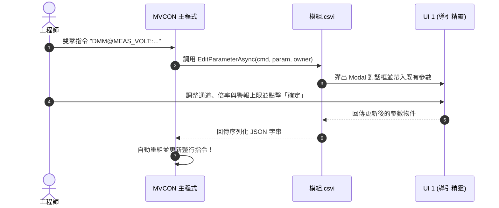

# MVCON CSVI (Configurable SubVI) 架構設計規範書
### 現代跨平台工業自動化模組體系 (C# + Avalonia)

---

## 📌 1. 設計哲學與背景 (Background & Philosophy)

在傳統工業量測與自動化測試（ATE）領域，**NI LabVIEW** 的 **VI（Virtual Instrument）** 架構具備無可取代的直覺優勢：
- **Block Diagram**：負責背景演算法與通訊（SubVI 呼叫）。
- **Front Panel**：負責視覺化儀表顯示，並可透過 SubPanel 嵌入主介面。
- **Express VI / Config Dialog**：使用者雙擊模組時，彈出參數精靈對話框導引設定。

然而，LabVIEW 存在**授權昂貴、執行檔龐大（需數 GB Runtime Engine）、無法靈活進行 Git 差異比對（Diff）、難以跨平台部署（如 Linux 工控機）**等痛點。

**MVCON CSVI（Configurable SubVI）** 旨在利用現代 **C# (.NET 8/9) + Avalonia UI** 框架，100% 傳承並升級 LabVIEW 的核心靈魂，實現：
1. **三位一體打包**：將「純底層演算法」、「UI 1 參數導引視窗」、「UI 2 運行前面板」封裝於同一個 DLL 組件。
2. **專屬副檔名 `.csvi`**：編譯後自動更名，支援主系統熱插拔（Hot-Plug）動態載入。
3. **DSL 結構化語法**：透過 `模組@指令::參數`，達成最高可讀性與腳本化儲存。
4. **極致效能分離**：產線全速批次執行時，完全不初始化 UI，達成零介面損耗的高速運算。

---

## 📜 2. 指令 DSL 語法規範 (Command DSL Specification)

MVCON 系統的核心調度完全基於簡潔的領域特定語言（DSL）：

$$\Large \mathbf{模組@指令::參數}$$

### 語法拆解：
* **`模組@` (Module Identifier)**：
  - 對應外掛模組的識別名稱（例如 `DMM@`, `CAM@`, `MOTION@`）。
  - 主程式藉此路由至對應的 `.csvi` 實體。
* **`@指令` (Command Action)**：
  - 該模組支援的具體動作或底層函數（例如 `@MEAS_VOLT`, `@SNAP`, `@MOVE_REL`）。
* **`::參數` (Parameters Payload)**：
  - 結構化文字格式（推薦 JSON），便於儲存為配方檔案（Recipe）、純文字腳本與 Git 版本控制。
  - **重要特性**：**使用者無需手動記憶或撰寫此段字串**，而是由模組自帶的 **UI 1（參數導引視窗）** 輔助生成！

### 典型指令範例：
```text
DMM@MEAS_VOLT::{"Channel":"ai0","ScaleFactor":1.0,"HighLimit":4.0}
CAM@EXPOSURE_SET::{"ExposureUs":2000,"Gain":1.5}
MOTION@AXIS_MOVE::{"Axis":"X","TargetMm":50.0,"Speed":10.0}
```

---

## 🏗️ 3. 模組架構：三位一體 (The Three Pillars)

每一個 `.csvi` 檔案本質上是一個標準的 .NET 動態連結庫（Assembly DLL），內部劃分為三個完全解耦但協同運作的支柱：

```text
┌────────────────────────────────────────────────────────┐
│                   MyModule.csvi                        │
│                                                        │
│  [支柱 1] 底層純運算引擎 (Core Engine)                 │
│    - 純 C# 類別，零 UI 依賴                           │
│    - 負責硬體通訊 (VISA/SCPI/DAQ)、影像處理、數學演算 │
│    - 供產線全速批次自動化執行 (SubVI 模式，無任何開銷)  │
│                                                        │
│  [支柱 2] UI 1: 參數導引視窗 (Config Wizard)           │
│    - 專門伺候「::參數」的編輯                          │
│    - 在腳本編輯器雙擊節點時彈出                        │
│    - 讓使用者拉拉桿、填通道，點確定後自動轉成參數字串  │
│                                                        │
│  [支柱 3] UI 2: 運行即時前面板 (Front Panel)           │
│    - 專門提供給主程式的 SubPanel 嵌入                  │
│    - 包含波形圖、指針、即時讀值與 Pass/Fail 燈號      │
│    - 底層在執行時，數據會即時同步推播到畫面上          │
└────────────────────────────────────────────────────────┘
```

### 3.1 核心介面定義 (`ICsviModule.cs`)

所有 `.csvi` 模組皆實作位於 `Mvcon.Contracts` 共享庫中的通用介面：

```csharp
namespace Mvcon.Contracts;

public interface ICsviModule
{
    // 模組識別資訊
    string ModuleName { get; }
    string DisplayName { get; }
    string Description { get; }
    IReadOnlyList<string> SupportedCommands { get; }

    // [支柱 2: UI 1] 針對指令彈出參數精靈視窗，回傳編輯後的 ::參數 字串
    Task<string?> EditParameterAsync(string command, string currentParamString, Avalonia.Controls.Window? owner = null);

    // [支柱 3: UI 2] 取得 Front Panel 控制項，供主程式動態掛載於 SubPanel 容器
    Avalonia.Controls.Control GetFrontPanelControl();

    // [支柱 1: 底層] 純背景高速執行 (SubVI 模式，零 UI 損耗)
    Task<object?> ExecuteCommandAsync(string command, string paramString, CancellationToken ct = default);
}
```

---

## ⚙️ 4. 模組生命週期與運作場景 (Operation Scenarios)

### 場景 1：流程編輯期（可視化參數導引）


### 場景 2：產線自動測試（全速批次模式）
- **行為**：主程式依照測試工步（Test Plan），直接迴圈調用 `ExecuteCommandAsync(cmd, param)`。
- **優勢**：模組內部**完全不實體化任何 Avalonia View 或視窗**，底層通訊與演算法以極速平行（Multi-Threading / Async）運作，無記憶體與畫面繪製浪費。

### 場景 3：工程師調試與即時監控（SubPanel 嵌入）
- **行為**：主介面配置 `<ContentControl Name="SubPanelContainer" />`。
- **切換**：`SubPanelContainer.Content = module.GetFrontPanelControl();`。
- **效果**：右側畫面瞬間變成萬用表或相機即時畫面；底層採樣時，透過 ViewModel 資料繫結（Data Binding）即時跳動更新。

---

## 📦 5. 專案建置與 `.csvi` 自動打包機制

透過 MSBuild Post-Build Target，編譯時全自動將目標產物從 `.dll` 複製並更名為 `.csvi`：

```xml
<Project Sdk="Microsoft.NET.Sdk">
  <PropertyGroup>
    <TargetFramework>net8.0</TargetFramework>
    <OutputType>Library</OutputType>
  </PropertyGroup>

  <!-- 建置完成後自動複製並改名為 .csvi 放進主程式 Plugins 目錄 -->
  <Target Name="ExportToCsvi" AfterTargets="Build">
    <Copy SourceFiles="$(TargetPath)" 
          DestinationFiles="..\..\Mvcon.Host\bin\$(Configuration)\net8.0\Plugins\$(TargetName).csvi" />
    <Message Importance="High" Text="[MVCON] 已成功產出 $(TargetName).csvi 外掛模組！" />
  </Target>
</Project>
```

---

## 🚀 6. 未來演進路線 (Roadmap)

1. **模組資料串接埠 (Port & Wiring Canon)**：支援類似 LabVIEW 端子盤（Connector Pane）的資料流管線直通。
2. **多視窗彈出 (Detached Mode)**：除 SubPanel 嵌入外，支援 Front Panel 獨立彈窗置頂，方便多螢幕除錯。
3. **熱插拔隔離載入器 (AssemblyLoadContext)**：支援不停機卸載與熱更新 `.csvi` 模組。
