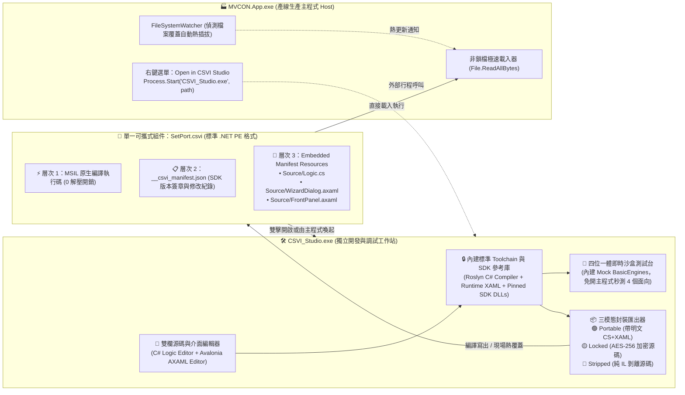

# MVCON CSVI 3.0 可攜式自包含規格與獨立 CSVI Studio 工具鏈設計書
### (Self-Contained Portable CSVI & Standalone CSVI Studio Toolchain Specification)

> **版本**：3.0 (Portable CSVI & Standalone Studio Edition)  
> **建立日期**：2026-10-28  
> **核心定位**：將 `.csvi` 從單純的編譯後 DLL 升級為「自帶可選 C# 與 Avalonia XAML 原始碼的可攜式虛擬儀表」，並透過獨立的 **`CSVI_Studio.exe`** 封裝完整編譯工具鏈（Toolchain）與標準 SDK 函式庫，強制對齊主程式 Runtime，實現現場免 Visual Studio 即時修改、即時預覽、重編打包與熱插拔。

---

## 一、 核心哲學與設計決策 (Architectural Philosophy)

### 1.1 為什麼需要將 `.cs` + `.axaml` 封裝進 `.csvi`？
在傳統 C# 外掛架構中，編譯後的 `.dll` 與原始碼（`.cs` / `.axaml`）是徹底分離的。一旦機台進入客戶端無塵室（Fab），現場工控機（IPC）沒有網路、沒有 Git、也沒有數十 GB 的 Visual Studio，現場工程師若需微調一行延遲參數、新增一個防呆條件或調整面板按鈕，往往束手無策。

透過 **CSVI 3.0 可攜式封裝（Self-Contained Portable CSVI）**：
- 一顆 `.csvi` 檔案本身即為 **「原生執行碼 (MSIL) ＋ 參數導引與子面板 UI ＋ 原始碼包 (.cs / .axaml)」** 的完美合體。
- 工程師只需將單一顆 `.csvi` 隨身攜帶，丟進任何裝有 `CSVI Studio` 的工控機，即可直接檢視並修改 C# 業務邏輯與 XAML 介面，現場重編並立即生效。
- 同時提供 **「是否攜帶原始碼」的三段式安全開關**（開放攜帶 / 密碼加密保護 / 徹底剝離原始碼），100% 對標並超越 LabVIEW 的 VI 保護機制（Block Diagram Password / Remove Block Diagram）。

### 1.2 為什麼 `CSVI Studio` 必須是獨立應用程式 (`CSVI_Studio.exe`)？
1. **產線執行與開發調試職責分離 (Runtime vs. SDK Separation)**：
   - **`MVCON.App.exe`（產線主程式 Host）**：專注於 24/7 高穩定度生產與微秒級排程，不掛載龐大的 Roslyn 編譯器，杜絕產線操作員誤改代碼的風險。
   - **`CSVI_Studio.exe`（獨立開發與調試工作站）**：對標 LabVIEW Development System，專職負責 CSVI 的原始碼編輯、UI 即時預覽、單步沙盒測試與編譯打包。
2. **完整內建 Toolchain，強制對齊函式庫與 Runtime (Zero ABI Mismatch)**：
   - 外掛動態載入最常見的災難是「函式庫版本不一致（DLL Hell）」。
   - `CSVI_Studio.exe` 內部直接綑綁 **完整編譯工具鏈（Roslyn `Microsoft.CodeAnalysis.CSharp` + `Avalonia.Markup.Xaml.Loader`）** 以及 **標準鎖定版參考庫 (`sdk_refs/`)**。
   - 所有 `.csvi` 強制基於 `CSVI Studio` 內建的標準函式庫進行編譯與校驗，確保產出的 `.csvi` 與 `MVCON.App.exe` Runtime 100% 二進位兼容（ABI Aligned）。
3. **吸收並全面取代舊式 `GuidanceRunner.exe`**：
   - `CSVI Studio` 既是編輯器與編譯器，也是獨立的「四位一體沙盒測試器（Standalone Sandbox）」。在 Windows 中直接雙擊 `.csvi` 即可用 `CSVI Studio` 開啟測試或編輯。

---

## 二、 雙核生態系互動架構圖 (`MVCON.App` + `CSVI Studio`)



---

## 三、 CSVI 3.0 單一檔案內部二進位結構規範

為了讓 `MVCON.App.exe` 在生產執行時保持 **0 解壓縮開銷**，`.csvi` **嚴禁使用外部 `.zip` 包裝**，而是維持 **100% 純粹的 .NET PE (Portable Executable DLL) 格式**，將原始碼與元數據存放於 PE 標頭內的 `.rsrc`（.NET `ManifestResource` 內嵌資源區段）：

### 3.1 內嵌資源虛擬檔案樹 (Embedded Virtual File Tree)
每一顆 `.csvi` 內部透過 `Assembly.GetManifestResourceStream()` 規範以下標準資源鍵值（Resource Names）：

| 內嵌資源名稱 (Manifest Resource Key) | 必備 / 可選 | 內容說明 |
| :--- | :---: | :--- |
| `CSVI.Manifest.json` | **必備** | 記錄組件元數據、目標 SDK 版本簽章、封裝模式、SHA-256 及現場修改歷史（Changelog Diff）。 |
| `CSVI.RuntimeXaml.Wizard.axaml` | **必備 (若有 UI 1)** | 供執行期 `AvaloniaRuntimeXamlLoader` 載入之參數導引視窗 XAML。 |
| `CSVI.RuntimeXaml.FrontPanel.axaml` | **必備 (若有 UI 2)** | 供執行期載入之 SubPanel / Driver HMI 前面板 XAML。 |
| `CSVI.Source.Bundle` | **可選 (依保護模式)** | 封裝所有 `.cs` 與 `.axaml` 原始碼檔案（明文 JSON 字典或 AES-256 加密位元組流）。 |

### 3.2 `CSVI.Manifest.json` 結構規範

```json
{
  "FormatVersion": "3.0",
  "Module": "IO",
  "CommandKey": "IO@SetPort",
  "ComponentType": "Command",
  "SdkSignature": "MVCON-SDK-8.0.1-Avalonia-11.0.10",
  "PackagingMode": "PortableOpen",
  "SourceEncrypted": false,
  "SourceSha256": "e3b0c44298fc1c149afbf4c8996fb92427ae41e4649b934ca495991b7852b855",
  "LastCompiledUtc": "2026-10-28T00:45:00Z",
  "LastAuthor": "IPC-STATION-01\\Engineer",
  "RevisionHistory": [
    {
      "Revision": 1,
      "TimestampUtc": "2026-10-28T00:45:00Z",
      "Author": "IPC-STATION-01\\Engineer",
      "Summary": "Adjusted default delay preset and added interlock check",
      "UnifiedDiff": "--- a/Logic.cs\n+++ b/Logic.cs\n@@ -97,1 +97,2 @@..."
    }
  ]
}
```

### 3.3 三種封裝保護模式詳細行為

| 模式枚舉 (`CsviPackagingMode`) | `CSVI.Source.Bundle` 狀態 | `MVCON.App` 執行行為 | `CSVI Studio` 開啟行為 |
| :--- | :--- | :--- | :--- |
| **`PortableOpen`**<br/>(開放攜帶模式) | UTF-8 明文壓縮封裝 `.cs` 與 `.axaml` | 正常高速執行 | 直接解出完整 C# 與 AXAML 源碼，可立即編輯、即時預覽、重編存檔。 |
| **`PasswordLocked`**<br/>(密碼保護模式) | PBKDF2 (100,000 次迭代) + **AES-256-GCM** 加密封裝 | 正常高速執行（執行碼位於 MSIL，不需密碼即可跑） | 可作為沙盒測試執行；但切換至「源碼編輯」分頁時，彈出密碼解鎖框，輸入正確密碼後方可解密編輯。 |
| **`StrippedRelease`**<br/>(純執行剝離模式) | **完全移除此資源區段**（0 bytes） | 正常高速執行 | 僅開放「沙盒測試台（測試 Execute / 彈窗 / 面板）」，源碼編輯區顯示「🔒 此 CSVI 為剝離原始碼之發行版」。 |

---

## 四、 四大底層技術瓶頸與標準工程解法

在實作 `CSVI Studio` 與動態編譯管線時，必須嚴格遵循以下四項工程規範以避開 .NET 與 Avalonia 的底層限制：

### 4.1 瓶頸一：Roslyn 記憶體編譯缺乏 MSBuild `XamlIl` 管線
- **問題**：傳統 Avalonia 專案依賴 MSBuild 在編譯期將 `.axaml` 轉為 `!Avalonia:!XamlIl` IL 注入組件。但 `CSVI Studio` 使用 Roslyn `CSharpCompilation` 在記憶體直接編譯 C#，不經過 MSBuild，若呼叫傳統 `AvaloniaXamlLoader.Load(this)` 會拋出找不到預編譯 XAML 的例外。
- **標準工程解法（雙軌 XAML 載入器 `CsviXamlLoader`）**：
  在 `MVCON.Core` 提供通用輔助函式 `CsviXamlLoader.Load(object controlInstance, string embeddedXamlResourceName)`：
  1. 優先檢查組件內是否存在 `CSVI.RuntimeXaml.*` 內嵌資源流，若有則直接呼叫 `AvaloniaRuntimeXamlLoader.Load(stream, rootInstance: controlInstance)`。
  2. 若無（例如舊版由 MSBuild 編譯的 DLL），則平滑回退呼叫 `AvaloniaXamlLoader.Load(controlInstance)`。
  3. **額外優勢**：在 `CSVI Studio` 編輯 AXAML 時，每敲擊一個字元即可直接呼叫 `AvaloniaRuntimeXamlLoader.Parse<Control>(liveXamlText)`，達成 **0 秒延遲的 Live UI Preview**！

### 4.2 瓶頸二：Toolchain 函式庫版本對齊與 `MetadataReference` 鎖定
- **問題**：現場電腦若安裝不同版本的全域套件，動態編譯容易發生型別簽名不匹配。
- **標準工程解法（Pinned SDK Reference Pack）**：
  `CSVI_Studio.exe` 部署目錄下固定配置標準參考目錄（或直接對齊同目錄下的 Runtime DLL）：
  - 核心必備引用清單：`System.Runtime.dll`, `System.Private.CoreLib.dll`, `System.Collections.dll`, `System.Linq.dll`, `System.Threading.Tasks.dll`, `System.ComponentModel.dll`, `Avalonia.Base.dll`, `Avalonia.Controls.dll`, `Avalonia.Interactivity.dll`, `Avalonia.Layout.dll`, `Avalonia.Visuals.dll`, `Avalonia.Markup.dll`, `Avalonia.Markup.Xaml.dll`, `Avalonia.Markup.Xaml.Loader.dll`, **`MVCON.Core.dll`**。
  - `CsviCompilerService` 啟動時預先將上述組件建立為不可變的 `ImmutableArray<MetadataReference>` 快取池，首次預熱後每次編譯僅需 **60 ~ 120 ms**。

### 4.3 瓶頸三：產線現場魔改導致的版本失控 (Configuration Drift)
- **問題**：工程師在產線直接修改 `.csvi` 後，若未留下記錄，日後無法追溯改了哪幾行代碼。
- **標準工程解法（內嵌 Diff 歷史追蹤）**：
  `CSVI Studio` 在按下「⚡ Build & Save」時，會自動比對修改前後的 `.cs` 與 `.axaml` 內容，自動生成標準 Unified Diff 並追加至 `CSVI.Manifest.json` 的 `RevisionHistory` 陣列中。任何一顆 `.csvi` 帶回研發中心，打開 `CSVI Studio` 的 **「📜 History / Diff」** 分頁，就能清楚看見該檔案在產線經歷過的所有修改軌跡，並支援一鍵匯出 `.cs` / `.axaml` 回寫至 Git 儲存庫。

### 4.4 瓶頸四：預覽與熱重載時的組件記憶體回收
- **標準工程解法**：
  - 所有檔案讀取一律採用 `File.ReadAllBytes(csviPath)`，確保檔案句柄 0 毫秒釋放，`CSVI Studio` 隨時可覆寫目標 `.csvi`。
  - 在 `CSVI Studio` 內部進行頻繁沙盒測試時，採用 `AssemblyLoadContext(name, isCollectible: true)` 載入新編譯的位元組流，避免重複編譯造成記憶體增長。

---

## 五、 `CSVI Studio` (`src/MVCON.CsviStudio`) 介面與功能規格

```text
+--------------------------------------------------------------------------------------------------+
| 🛠️ MVCON CSVI Studio v3.0 - [MODULES/IO/SetPort.csvi]          SDK: MVCON-SDK-8.0.1 [✔ ALIGNED] |
+--------------------------------------------------------------------------------------------------+
| [📂 Open .csvi] [✨ New CSVI] [⚡ Build & Save .csvi (Ctrl+S)] | Mode: [🟢 Portable (With CS+XAML) ▼] |
| [🔑 Set Password] [📤 Export Source to Folder] [🔄 Batch Align Directory]                        |
+------------------------------------------------+-------------------------------------------------+
| [📄 Logic.cs] [🎨 Wizard.axaml] [🎛️ Panel.axaml] | 🔍 LIVE SANDBOX & PREVIEW                       |
| [📜 Revision History & Diff (Rev 2)]           | +---------------------------------------------+ |
|------------------------------------------------| | [Tab 1: FrontPanel / SubPanel Live Preview] | |
|   1 | using System;                            | | [Tab 2: Test Parameter Wizard Dialog]       | |
|   2 | using MVCON.Core.Guidance;               | | [Tab 3: Headless Execute() Benchmark]       | |
|   3 |                                          | |---------------------------------------------| |
|   4 | namespace MVCON.Module.IO.Guidance;      | |  🟢 P0.0 Safety Door   [ON]  [Toggle]       | |
|   5 |                                          | |  ⚫ P0.1 Start Button  [OFF] [Toggle]       | |
|   6 | public class IoSetPortGuidance : ...     | |                                             | |
|   7 | {                                        | |  Test Param: [ P0.0,0.2          ] [▶ Run]  | |
|   8 |     public override string CommandKey    | |  Result: Done (Elapsed: 0.018 ms)           | |
|   9 |         => "IO@SetPort";                 | +---------------------------------------------+ |
+------------------------------------------------+-------------------------------------------------+
| 💬 COMPILER & DIAGNOSTICS OUTPUT                                                                 |
| [08:45:12] ✔ Roslyn Compilation Succeeded in 78 ms -> D:\...\MODULES\IO\SetPort.csvi (82.4 KB)   |
| [08:45:12] ✔ Embedded 3 source files (Mode: PortableOpen, SHA256: 9f8a...c12b)                   |
+--------------------------------------------------------------------------------------------------+
```

---

## 六、 下一階段實作推進清單 (Implementation Checklist)

供下一階段長時程開發直接按步執行：

- [ ] **Step 1：核心可攜式容器與雙軌 XAML 載入器 (`MVCON.Core`)**
  - 新增 `MVCON.Core/Csvi/CsviManifest.cs`（定義 Manifest、RevisionEntry 與 `CsviPackagingMode`）。
  - 新增 `MVCON.Core/Csvi/CsviSourceBundle.cs`（實作明文 GZip 打包與 AES-256-GCM 加密/解密）。
  - 新增 `MVCON.Core/Csvi/CsviXamlLoader.cs`（支援優先從內嵌 `CSVI.RuntimeXaml.*` 動態載入 XAML，無縫相容 Roslyn 記憶體編譯）。
- [ ] **Step 2：建立獨立專案 `src/MVCON.CsviStudio` (`CSVI_Studio.exe`)**
  - 引用 `Microsoft.CodeAnalysis.CSharp` (Roslyn) 與 `Avalonia.Markup.Xaml.Loader`。
  - 實作 `CsviCompilerService.cs`：鎖定標準 SDK `MetadataReference` 清單，在記憶體中編譯 `.cs` 並將 `.axaml`、`CSVI.Manifest.json` 與 `CSVI.Source.Bundle` 寫入 PE `ManifestResource`。
  - 實作 `CSVI Studio` 主視窗（左欄 C# / AXAML 程式碼編輯器 + 歷史 Diff 檢視器，右欄 Live UI 預覽與四位一體沙盒測試台，頂部三模態打包切換與批次升級工具）。
- [ ] **Step 3：主程式 `MVCON.App` 外部連動整合**
  - 在 Sequencer 與 `Modules Info` 加入「🛠️ Open in CSVI Studio」按鈕/右鍵選單，呼叫 `CSVI_Studio.exe "<csviPath>"`。
  - 更新 `tools/pack_runtime.ps1`：將 `CSVI_Studio.exe` 一併發布至 `dist/MVCON_Runtime/`，並將 14 個 IO `.csvi` 與 `MockIO.csvi` 預設封裝為 `PortableOpen` 模式（內嵌完整 `.cs` 與 `.axaml`）。
- [ ] **Step 4：單元測試與 Desktop Cockpit 全流程實機驗證**
  - 測試三種模式（`PortableOpen` / `PasswordLocked` / `StrippedRelease`）之編譯、提取、密碼驗證與執行。
  - 在 Desktop Cockpit 啟動 `CSVI_Studio.exe` 載入 `SetPort.csvi` ➔ 現場修改代碼與 XAML ➔ 點擊 Build & Save ➔ 驗證 `MVCON.App.exe` 自動熱更新生效。
