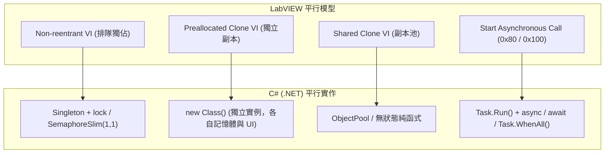
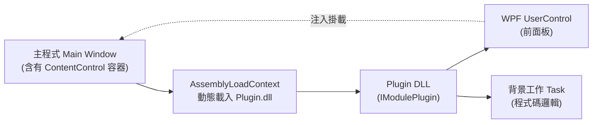

# LabVIEW 轉 C# (.NET / WPF) 基本作業語法與架構對照手冊

本手冊專為熟悉 **LabVIEW 資料流（Dataflow）與模組化架構（如 MVCON / QMH / Actor Framework）** 的工程師設計，旨在提供轉換為 **C# (.NET 8+ / WPF)** 時的語法對應、平行處理、動態載入與 UI 整合的實戰參考。

---

## 1. 核心流程與語法結構對照 (Flow Control & Syntax)

| 概念 | LabVIEW (G 語言) | C# (.NET) 語法實作 | 備註說明 |
| :--- | :--- | :--- | :--- |
| **條件分支** | **Case Structure** (布林 / 列舉 / 錯誤線) | `if-else` 或 `switch-case` / Pattern Matching | C# 支援模式匹配，例如 `switch (state)` |
| **條件迴圈** | **While Loop** 搭配 Stop Condition | `while (!cts.IsCancellationRequested)` | 工控迴圈強烈建議搭配 `CancellationToken` |
| **固定次數迴圈** | **For Loop** 搭配 Loop Count (N) | `for (int i = 0; i < n; i++)` | C# 陣列索引以 0 開始 |
| **集合走訪** | **For Loop** 自動索引 (Auto-indexing) | `foreach (var item in collection)` 或 LINQ | 走訪集合首選 `foreach` |
| **前後狀態傳遞** | **Shift Register** (移位暫存器) | 迴圈外部變數 / 狀態物件 / `ref` 參數 | 在 C# 中直接在迴圈外宣告變數並在迴圈內遞迴更新 |
| **序列執行** | **Flat Sequence Structure** | 循序程式行由上往下執行 | C# 本身即為指令式循序執行，不需要框線強制順序 |
| **錯誤叢集** | **Error Cluster** (`status`, `code`, `source`) | `try { ... } catch (Exception ex) { ... }` 或 `Result<T>` | 推薦搭配自訂工控錯誤類別或包含錯誤碼的結構 |

### 程式碼範例：Shift Register（移位暫存器）與狀態機

#### LabVIEW
While Loop 搭配 Shift Register 累計數值或輪轉狀態：
```
[State In] ---> [ Case Structure ] ---> [State Out]
```

#### C#
```csharp
public enum MachineState { Idle, Running, Paused, Error, Stopped }

public async Task RunStateMachineAsync(CancellationToken token)
{
    MachineState currentState = MachineState.Idle; // 移位暫存器初始值
    int counter = 0;

    using var timer = new PeriodicTimer(TimeSpan.FromMilliseconds(50));
    while (!token.IsCancellationRequested && await timer.WaitForNextTickAsync(token))
    {
        // 相當於 Case Structure
        currentState = currentState switch
        {
            MachineState.Idle => counter > 0 ? MachineState.Running : MachineState.Idle,
            MachineState.Running => counter >= 100 ? MachineState.Stopped : MachineState.Running,
            _ => MachineState.Error
        };

        counter++; // 狀態與數據在迴圈中更新 (相當於下一圈的 Shift Register)
    }
}
```

---

## 2. 資料結構與型別映射 (Data Types)

| LabVIEW 型別 | C# 型別 | 記憶體特性 / 說明 |
| :--- | :--- | :--- |
| **Boolean** (綠色) | `bool` | `true` / `false` |
| **U8 / I16 / I32 / I64** (藍色) | `byte` / `short` / `int` / `long` | 整數型別對齊 |
| **SGL / DBL** (橘色) | `float` / `double` | 浮點型別（高精度測量多用 `double`） |
| **String** (粉紅色) | `string` | UTF-16 不可變字串 |
| **Path** (青色) | `string` / `System.IO.FileInfo` | 建議統一使用 `System.IO.Path.Combine()` |
| **Array** (陣列) | `T[]` / `List<T>` | 動態伸縮多用 `List<T>`，固定長度用 `T[]` |
| **Cluster** (叢集) | `struct` / `class` / `record` | 輕量數據傳遞建議使用 `record` (具值相等性) |
| **Queue / Notifier** | `Channel<T>` / `BlockingCollection<T>` | 高效能非同步訊息傳遞與生產者-消費者模式 |

---

## 3. 平行處理與執行特性對應 (Concurrency & Reentrancy)



### 3.1 Non-reentrant vs Preallocated Clone

- **Non-reentrant（全域排隊/互斥）**：
  ```csharp
  public class MotionController
  {
      private static readonly SemaphoreSlim _lock = new(1, 1);

      public async Task MoveAxisAsync(int axisId, double position)
      {
          await _lock.WaitAsync(); // 等待進入，排隊執行
          try
          {
              // 獨佔硬體動作
          }
          finally
          {
              _lock.Release();
          }
      }
  }
  ```

- **Preallocated Clone（獨立實例）**：
  ```csharp
  // 每個軸或相機各 new 一個實體，各自佔有獨立記憶體與狀態，完全互不干擾
  var axisX = new SingleAxisController("Axis_X");
  var axisY = new SingleAxisController("Axis_Y");
  ```

### 3.2 異步呼叫：Call & Forget (0x80) 與 Call & Collect (0x100)

```csharp
// 1. Call & Forget (射後不理，對應 LabVIEW 0x80)
_ = Task.Run(() =>
{
    module.ExecuteContinuousLogging();
});

// 2. Call & Collect (等待並收集結果，對應 LabVIEW 0x100 + Wait On Async Call)
Task<InspectResult> cam1Task = Task.Run(() => cam1.Inspect());
Task<InspectResult> cam2Task = Task.Run(() => cam2.Inspect());

// 等待所有任務完成，且完全不阻塞主視窗 UI
InspectResult[] results = await Task.WhenAll(cam1Task, cam2Task);
```

---

## 4. 前面板與動態載入架構 (SubPanel vs WPF ContentControl)

在 LabVIEW 中使用 **VI Server (`Open VI Reference` + `Insert SubPanel`)** 來做畫面動態鑲嵌。在 C# WPF 中，標準架構是透過 **介面契約（Interface）+ 插件 DLL + UserControl 嵌入**。



### 4.1 插件介面定義 (IModulePlugin)

```csharp
public interface IModulePlugin
{
    string ModuleName { get; }
    
    // 對應 LabVIEW 前面板 UI
    System.Windows.FrameworkElement View { get; }
    
    // 初始化與背景邏輯啟動
    Task InitializeAsync(CancellationToken token);
    
    // 釋放與關閉 (對應 Close VI Reference)
    Task ShutdownAsync();
}
```

### 4.2 動態載入並鑲嵌至主畫面 (SubPanel 替代方案)

```csharp
using System.IO;
using System.Reflection;
using System.Runtime.Loader;
using System.Windows.Controls;

public class PluginLoader
{
    public static IModulePlugin LoadModule(string dllPath, ContentControl subPanelContainer)
    {
        // 1. 使用 AssemblyLoadContext 支援獨立依賴與後續卸載 (Unload)
        var context = new AssemblyLoadContext(Path.GetFileNameWithoutExtension(dllPath), isCollectible: true);
        var assembly = context.LoadFromAssemblyPath(dllPath);

        // 2. 尋找實作 IModulePlugin 的類別
        var pluginType = assembly.GetTypes().FirstOrDefault(t => typeof(IModulePlugin).IsAssignableFrom(t) && !t.IsInterface);
        if (pluginType == null) throw new InvalidOperationException("找不到有效的外掛實作");

        var plugin = (IModulePlugin)Activator.CreateInstance(pluginType)!;

        // 3. 嵌入到主視窗的 SubPanel (ContentControl)
        subPanelContainer.Content = plugin.View;

        // 4. 啟動背景任務
        _ = plugin.InitializeAsync(CancellationToken.None);

        return plugin;
    }
}
```

---

## 5. 外掛三層隔離架構 (Isolation Strategies)

針對工控系統穩定度，C# 提供三種隔離深度：

| 隔離層次 | 實現技術 | 邏輯執行緒 | UI 執行緒 | 防禦等級 | 適用情境 |
| :--- | :--- | :--- | :--- | :--- | :--- |
| **Level 1: 標準模式** | `UserControl` + `Task.Run()` + `AssemblyLoadContext` | 完全獨立 | 共用主視窗 UI Thread | 邏輯不卡死；需遵守 MVVM 不阻塞 UI 事件 | 90% 標準工控設備與量測外掛 |
| **Level 2: 獨立 UI 執行緒** | 專屬 STA Thread + `Dispatcher.Run()` + `HostVisual` | 完全獨立 | 各 DLL 獨立 UI 執行緒 | 極高；單一外掛狂刷圖表不影響主畫面流暢度 | 高頻波形圖、即時 AOI 影像顯示 |
| **Level 3: 跨程序物理隔離** | 獨立編譯為 `.exe` + `HwndHost` / Win32 `SetParent` | 獨立 OS Process | 獨立 OS Process | 100% 物理隔離；DLL 發生 Access Violation 主程式不閃退 | 不穩定之第三方硬體 Driver、C/C++ 相機 SDK |

---

## 6. LabVIEW VI 到 C# 虛擬儀表 (CSVI) 的四位一體映射

在原廠 LabVIEW MVCON 架構中，雖然單一 VI 同時具備 Front Panel 與 Block Diagram，但由於執行與參數編輯彈窗的調用簽名完全不同，導致過去的架構必須切出 `USERPARAMETEREDITOR/` 目錄專門放置彈窗 VI。

### 6.1 CSVI (C# Virtual Instrument) 的四位一體統一

在 **MVCON SHARP** 中，開創了 `.csvi`（C# 虛擬儀表）架構，**一個組件同時具備四個面向**：

| 面向 | LabVIEW 概念對應 | C# CSVI 實作方法 | 執行情境 |
| :--- | :--- | :--- | :--- |
| **1. 純執行** | Block Diagram (微秒級執行) | `Execute(ctx, action, param)` | Sequencer 自動化量產，0ms UI 開銷 |
| **2. 參數導引視窗** | 獨立 Dialog VI (彈窗編輯) | `ShowGuidanceDialogAsync(...)` | 雙擊表格參數欄，動態列出硬體點位防止手動打字拼錯 |
| **3. 即時運算可視化** | Highlight Execution / Probes | `NotifyExecution(...)` 事件匯流排 | 執行時將計算數值、通訊耗時即時推播至面板 |
| **4. SubPanel 與 Driver HMI** | SubPanel 插入 VI 前面板 | `GetFrontPanelControl()` | 嵌入主程式 `User Tab` 動態子面板，亦作為 Driver 監控介面 |

### 6.2 終結 `USERPARAMETEREDITOR` 冗餘目錄：目錄驅動探索

在全新 CSVI 架構下：
1. **指令目錄探索**：`MODULES/<Module>/*.csvi`。目錄下有多少個 `.csvi` 檔案，主程式就支援多少指令；每個 `.csvi` 本身就內建導引對話框與前面板，**完全不再需要 `USERPARAMETEREDITOR` 目錄**。
2. **驅動目錄探索**：`MODULES/<Module>/DRIVER/*.csvi`。目錄下有多少 `.csvi` 驅動，主程式 `Modules Info` 就動態顯示多少驅動卡片與其專屬控制面板。
3. **熱插拔非鎖檔載入**：透過 `File.ReadAllBytes` 載入記憶體，產線運轉中隨時可覆蓋更新組件，達成零停機熱更新。

---

## 7. 總結遷移檢核清單 (Migration Checklist)

1. [ ] **消除全域共用變數**：以相依性注入（Dependency Injection）或訊息通道（`Channel<T>`）替代 LabVIEW Global Variable。
2. [ ] **While Loop 加上防呆與定時**：務必使用 `PeriodicTimer` 或 `Task.Delay`，避免佔用 100% CPU，並傳遞 `CancellationToken`。
3. [ ] **SubPanel 轉為 ContentControl**：將前面板包裝為 WPF `UserControl`，由外掛工廠反射回傳。
4. [ ] **跨執行緒更新 UI**：背景任務切勿直接存取 UI 控制項，使用 `Dispatcher.BeginInvoke()` 或標準 MVVM `INotifyPropertyChanged` 資料綁定。
5. [ ] **動態模組隔離**：若引用的硬體驅動可能造成行程崩潰，優先評估採用 Level 3（跨程序宿主）或 Level 2（獨立 UI 執行緒）架構。
