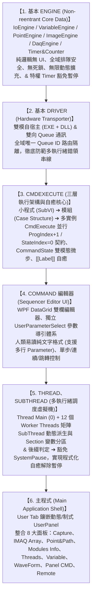

# MVCON C# (.NET 8+ / Avalonia UI 11 + ScottPlot.Avalonia) 跨平台系統開發路線與函式規格手冊 (Development Roadmap & API Spec)

> **🎯 跨平台核心決策**：
> 為達成 **Windows PC 與 Linux PC 雙向 100% 原生無縫執行**，表現層全面採用 **Avalonia UI 11** 搭配 **ScottPlot.Avalonia 5** 與 **SkiaSharp**，徹底剔除 Windows-only WPF 限制。同一份 C# / XAML 代碼在 Windows 產出原生 `.exe`，在 Linux 產出原生 ELF 執行檔，並支援 Linux DRM/KMS 無桌面純工控直出模式。

本手冊依據 MVCON 的核心設計哲學，嚴格遵循**由底而上、逐步推進的六大編程順序**進行設計與實作。每個模組皆列出應實作之核心資料結構與函式簽名，作為開發與驗收之 Check 清單。

---

## 🗺️ 開發順序總覽 (Master Pipeline)



---

## 📌 第一階段：基本 ENGINE (`MVCON.Core.dll`) 實作規格與函式清單

> **🔥 核心架構約束**：
> 1. **純邏輯核心（Headless & Pure Logic DLL）**：不包含任何 UI 控制項、不引用 WPF，僅提供資料存取與事件通知。
> 2. **Non-reentrant 排隊獨佔**：內部統一透過鎖（`lock`）排隊執行，100% 執行緒安全。
> 3. **無限動態擴充 & `NameIndex` 管理**：萬物皆以名稱索引，無固定容量上限，並自動將狀態旗標回寫至 `IoEngine` 的 `$(Name)#XXX?` 虛擬 IO。

---

### 1.1 `IoEngine` (動態無限 IO 池)
- **內部狀態**：
  - 實體點位池（預設 `P0.0` ~ `P63.7`，超過時自動動態擴充 `Pn.m`）。
  - 雙向別名映射表（`P0.0 <-> StartBtn?`）。
  - 虛擬 IO 字典（如 `ThreadMain#Run?`、`Cam0#OK?`、`Watchdog#Timeout?`）。
  - 內建唯讀常數：`"True"` (恆為 `true`)、`"False"` (恆為 `false`)。
- **待實作函式清單 (Check List)**：
  - [x] `bool GetPort(string nameOrPort)` — 單點讀取（支援實體點號、別名、虛擬 IO、`True`/`False`；找不到拋出例外）。
  - [x] `void SetPort(string nameOrPort, bool value)` — 單點寫入（若為 `#` 系統旗標且不存在則自動建立；`"True"`/`"False"` 忽略寫入）。
  - [x] `void SetPortName(string physicalPort, string aliasName)` — 綁定實體點位與別名（對應 `IO@SetPortName`）。
  - [x] `void AddVirtualIO(string name, bool initialValue)` — 新增或覆寫虛擬 IO（對應 `IO@AddVirtualIO`）。
  - [x] `void Shift(IReadOnlyList<string> ioNames, int shiftCount)` — 批次移位一組 IO 狀態，支援正負方向（對應 `IO@Shift`）。
  - [x] `bool[] GetBatch(string startPort, int bitCount)` — **【Driver Output 搬運】** 從起始點一次批次取出連續 `bitCount` 個布林值。
  - [x] `void SetBatch(string startPort, ReadOnlySpan<bool> values)` — **【Driver Input 搬運】** 從起始點一次整批寫入硬體讀回的布林陣列。
  - [x] `Dictionary<string, bool> GetPortsBatch(IEnumerable<string> names)` — 依名稱清單批次讀取多個點位狀態。
  - [x] `IReadOnlyList<IoPortSnapshot> GetAllSnapshot()` — 取得所有點位快照（供 UI 列表與 Telnet `$GetIO` 使用）。
  - [x] `event Action<string, string, bool>? IoChanged` — 當點位狀態實際改變（`old != new`）時觸發通知 `(Port, Alias, NewValue)`。

---

### 1.2 `VariableEngine` (多層級動態符號表)
- **內部狀態**：
  - 分區字典 `Dictionary<string, SectionScope>`：內建 `"Global"`，並隨 `Thread0~12` 及各 `SubThread` 動態建立專屬 Section。
  - 變數條目 `VariableEntry`：包含 `Key`、`RawValue`（字串）、以及陣列格式 `"[A;B;C]"` 專用的內部讀取游標 `CurrentIndex`。
- **作用域規則**：
  - 指定分區（`Key@Section` 或 `$(Key@Section)`）：直接查指定 `Section`，找不到報錯。
  - 未指定分區：先查當前 `currentSection` $\rightarrow$ 找不到回退查 `"Global"` $\rightarrow$ 再找不到拋出例外。
- **待實作函式清單 (Check List)**：
  - [x] `string Get(string keyExpr, string currentSection = "Global")` — 讀取變數值（支援 `Key@Section`；若值為陣列 `[A;B;C]` 則回傳目前 `CurrentIndex` 指向的元素）。
  - [x] `string GetRaw(string keyExpr, string currentSection = "Global")` — 讀取未拆解的完整原始字串（供 UI 表格顯示）。
  - [x] `void Set(string key, string value, string targetSection = "Global")` — 設定變數值並將 `CurrentIndex` 歸 0（對應 `Variable@Set`）。
  - [x] `bool Delete(string key, string targetSection = "Global")` — 刪除指定變數（對應 `Variable@Delete`）。
  - [x] `void Rename(string oldKey, string newKey, string targetSection = "Global")` — 重新命名變數（對應 `Variable@Rename`）。
  - [x] `void ClearSection(string section)` — 清空指定分區變數。
  - [x] `string FilterParameters(string rawParam, string currentSection)` — **【對應 `Param Filter Prog`】** 將參數字串中的 `$(Var@Sec)`、`$(Var)`、`$Var@Sec`、`$Var` 查表替換為實際值。
  - [x] `void Inc(string key, double step = 1, string section = "Global")` / `Dec(...)` — 數值累加與遞減（對應 `Variable@Inc` / `Dec`）。
  - [x] `void Append(string key, string suffix, string section = "Global")` — 字串尾端拼接（對應 `Variable@Append`）。
  - [x] `void Trim(string key, int start, int length, string section = "Global")` — 子字串擷取（對應 `Variable@Trim`）。
  - [x] `void Slice(string key, string separator, string section = "Global")` — 字串切割並轉為 `[A;B;C]` 陣列格式（對應 `Variable@Slice`）。
  - [x] `void Joint(string key, string separator, string section = "Global")` — 陣列元素合併為單一字串（對應 `Variable@Joint`）。
  - [x] `void LResetIndex(string key, int index = 0, string section = "Global")` — 設定陣列游標位置（對應 `Variable@LResetIndex`）。
  - [x] `void LSetIndexValue(string key, int index, string val, string section = "Global")` — 修改陣列指定索引元素（對應 `Variable@LSetIndexValue`）。
  - [x] `bool LMoveNext(string key, string section = "Global")` — 陣列游標 `+1`，未到底回傳 `true`（供 `Thread@ForeachLoop` 使用）。
  - [x] `void LPush(string key, string val, string sec = "Global")` / `RPush(...)` — 陣列左端/右端推入元素。
  - [x] `string LPop(string key, string sec = "Global")` / `RPop(...)` — 陣列左端/右端彈出並移除元素。
  - [x] `void LRemove(string key, string targetVal, string sec = "Global")` / `LReverse(...)` — 陣列元素移除與反轉。
  - [x] `(int Index, int Size) LGetIndexSize(string key, string sec = "Global")` — 取得陣列目前游標與總長度。
  - [x] `bool LFindIndexSet(string keyArr, string targetVal, IEnumerable<string> linkedArrs, string sec = "Global")` — **【主鍵檢索連動】** 搜尋 `keyArr` 命中索引後，同步切換所有 `linkedArrs` 的游標位置。
  - [x] `void SaveToFile(string filePath, IEnumerable<string>? keys = null)` / `LoadFromFile(string filePath)` — 變數檔案持久化。
  - [x] `IReadOnlyDictionary<string, string> GetSectionSnapshot(string section)` — 取得分區完整鍵值快照供 UI 顯示。

---

### 1.3 `PointEngine` (全域點位陣列庫)
- **內部狀態**：
  - 全域字典 `Dictionary<string, PointArrayEntry>`（點位為 Global 共享，每個名稱對應 `List<MachinePoint>` 陣列，單點即長度 1 的陣列）。
  - `MachinePoint` 結構：
    - `double X, Y, Z, U, V, W`（預設 `0.0`；軸值為 `double.PositiveInfinity` 即 `inf` 代表屏蔽該軸保持原位）。
    - `JsonObject H`：**統一為 JSON 字典**，可任意存入製程參數、夾爪狀態、半徑等 Key-Value。
  - 內部游標 `CurrentIndex` 與終點旗標（自動連動 `IoEngine` 的 `$(PointName)#Last?`）。
- **待實作函式清單 (Check List)**：
  - [x] `MachinePoint GetPoint(string pointExpr)` — 解析 `"P1"`（取目前游標點）、`"Tray[3]"`（取指定索引點）、`"P1@XY"`（僅保留 XY 其餘設 `inf`）、`"P1@Z(50)"`（覆寫 Z 其餘設 `inf`）。
  - [x] `IReadOnlyList<MachinePoint> GetPointArray(string name)` — 取得該名稱的完整點位陣列。
  - [x] `void SetPoint(string name, MachinePoint point)` — 覆寫為長度 1 的單點陣列，游標歸 0（對應 `Calculate::$P=(...)`）。
  - [x] `void AppendPoint(string name, MachinePoint point)` — 將點位壓入陣列尾端（對應 `Calculate::$P<=(...)`）。
  - [x] `MachinePoint GetAndMoveNextPallet(string name)` — 取出目前游標點位並將游標推進，抵達末點時將 `IoEngine` 的 `$(name)#Last?` 設為 `true`（供 `GoPallet` 使用）。
  - [x] `void ResetPalletIndex(string name, int index = 0)` — 重設料盤游標並更新 `$(name)#Last?`（對應 `ResetPalletIndex`）。
  - [x] `bool CheckPalletLast(string name)` — 檢查是否在最後一點並同步 `$(name)#Last?`（對應 `CheckPalletLast?`）。
  - [x] `void EnableAxis(string name, string enabledAxes)` — 保留指定軸向（如 `"XYZ"`），其餘軸設為 `inf`（對應 `EnableAxis`）。
  - [x] `void GeneratePallet1D(string name, int totalCount)` — 依 `[0]`起點、`[1]`終點等距產生 1D 點位陣列（對應 `Pallet1D`）。
  - [x] `void GeneratePallet2D(string name, int countX, int countY)` — 依 `[0]`原點、`[1]`X終點、`[2]`Y終點產生 2D 矩陣陣列（對應 `Pallet2D`）。
  - [x] `void GenerateCircle2DPath(string name, double startDeg, double endDeg, int segments)` — 依圓心、起點、終點產生圓弧分割路徑（對應 `Circle2DPath`）。
  - [x] `void Point2WS(string pointName, string wsName)` / `WS2Point(...)` — 機構座標與工作區座標正逆轉換。
  - [x] `void SelfMotion(string pointName, string basePtName, string newPtName)` — 剛體旋轉與平移偏差補償。
  - [x] `bool CheckInRangeXY(string pointName, string rangePtName)` — 檢查點位是否在矩形範圍內，寫入 `$(pointName)#InRange?`。
  - [x] `IReadOnlyList<string> GetAllNames()` — 取得所有點位名稱清單（供 UI `[GetList]` 使用）。

---

### 1.4 `ImageEngine (IMAQ)` (彈性影像與 Overlay/ROI 記憶體池)
- **內部狀態**：
  - 全域字典 `Dictionary<string, ImaqArrayEntry>`（每個名稱對應 `List<ImaqFrame>` 陣列，單張取像即長度 1 的陣列，飛拍為多幀陣列）。
  - `ImaqFrame` 結構：
    - `OpenCvSharp.Mat Image`（底層統一格式，透過 `OpenCvSharp4.WpfExtensions` 零分配直刷 UI `WriteableBitmap`，無須轉檔）。
    - `DateTime Timestamp`（毫秒級取像時間戳記 `00:00:00.000`）。
    - `List<OverlayShape> Overlays`（非破壞性檢測結果向量疊加層：圓、線、十字、文字、顏色，不污染原始 `Mat` 像素）。
    - `string RoiString`（互動式 ROI 描述字串）。
  - 內部游標 `CurrentIndex` 與終點旗標（連動 `IoEngine` 的 `$(Name)#Last?` 與 `$(Name)#OK?`）。
- **待實作函式清單 (Check List)**：
  - [x] `void SetSingleImage(string name, Mat image)` — 覆寫單張影像（自動安全 `Dispose` 舊圖），更新時間戳並設 `$(name)#OK? = true`。
  - [x] `void AppendImage(string arrayName, Mat image)` — 將新影像與當下時間戳壓入陣列尾端（供飛拍 `Trigger` / `Snap` 使用）。
  - [x] `ImaqFrame GetFrame(string nameExpr)` — 支援 `"Cam0"`（取目前游標幀）或 `"FlyArr[5]"`（取指定幀）。
  - [x] `IReadOnlyList<ImaqFrame> GetFrameArray(string name)` — 取得完整飛拍陣列與時間戳列表（供 `IMAQ Array` 頁面顯示）。
  - [x] `void ClearImaq(string name)` — 釋放該名稱下所有 `Mat` 記憶體並清空陣列，游標歸 0（對應 `Capture@ClearImaq`）。
  - [x] `void SetIndex(string name, int index)` / `MoveNext(string name)` — 切換檢視幀索引並更新 `$(name)#Last?`。
  - [x] `void AddOverlay(string name, OverlayShape shape)` / `ClearOverlays(string name)` — 在非破壞性向量層新增或清除演算法標註。
  - [x] `void SetRoi(string name, string roiString)` / `string GetRoi(string name)` — 設定與讀取 ROI 參數（對應 `Capture@ROISet`）。
  - [x] `void SetCoord(string name, IReadOnlyList<MachinePoint> refPoints)` — 設定影像空間校正座標系（對應 `Capture@CoordSet`）。
  - [x] `void SaveImage(string name, string filePath, bool includeOverlays = false)` — 儲存影像至硬碟（對應 `Capture@ImageSave`）。
  - [x] `void LoadImage(string name, string filePath)` — 從硬碟載入圖檔作為虛擬取像（對應 `Capture@LoadFile`）。
  - [x] `IReadOnlyList<string> GetAllNames()` — 取得所有影像陣列名稱清單。
  - [x] `event Action<string, int>? ImageUpdated` — 通知 UI `VisionViewerControl` 即時刷新畫面。

---

### 1.5 `DaqEngine` (動態多通道波形採樣佇列)
- **內部狀態**：
  - 全域字典 `Dictionary<string, WaveformEntry>`（每個名稱支援多通道 `List<WaveformChannelData>`）。
  - `WaveformChannelData` 結構：`DateTime T0`（起始時間）、`double Dt`（取樣間隔秒數）、`double[] Y`（振幅陣列，可直接零轉換餵給 `ScottPlot` 的 `SignalPlot`）。
- **待實作函式清單 (Check List)**：
  - [x] `void SetWaveform(string name, DateTime t0, double dt, double[] yData, int channel = 0)` — 存入完整採樣波形。
  - [x] `void AppendSamples(string name, ReadOnlySpan<double> samples, int channel = 0)` — 連續採樣模式下批次追加樣本點。
  - [x] `double GetInstantValue(string name, int channel = 0)` — 取得最新單點數值（對應 `DAQ@AnalogIn`）。
  - [x] `WaveformEntry GetWaveform(string name)` — 取得完整多通道波形資料（供 `WaveForm` 頁面與 `Display2User` 繪圖）。
  - [x] `void ApplyFilter(string name, DaqFilterType filterType, double param = 0)` — 數位濾波去毛刺（對應 `DAQ@Filter`）。
  - [x] `bool CompareMaxMinInRange(string name, double max, double min)` — 極值公差檢查，寫入 `$(name)#OK?`（對應 `DAQ@CompareMaxMinInRange`）。
  - [x] `bool CompareCoverBy(string name, string upperSpecName, string lowerSpecName)` — **【包絡線檢測】** 逐點比對是否落在上下限包絡線內（對應 `DAQ@CompareCoverBy`）。
  - [x] `IReadOnlyList<string> GetAllNames()` — 取得所有波形名稱清單（供 UI `[GetWaveForm]` 使用）。

---

### 1.6 `TimerEngine` & `CounterEngine` (名稱索引計時器與計數器)
- **`&` 後綴特權與 `SystemPause` 暫停凍結規則**：
  - **普通計時器（無 `&` 後綴，如 `DelayTimer`）**：受 `SystemPause` 影響。系統暫停期間**凍結累計經過時間**（排除/扣除暫停時間段），避免操作員手動暫停機台檢修或排除障礙時，引發動作逾時誤報。
  - **特權計時器（以 `&` 結尾，如 `SystemTimeout&`、`Watchdog&`）**：**完全不受 `SystemPause` 影響**。即使全機處於 `SystemPause` 狀態，仍持續以真實時鐘（Wall-clock time）精準計時走時，專供安全監控、硬體看門狗與暫停逾時自癒流程。
- **待實作函式清單 (Check List)**：
  - [x] `void SetSystemPause(bool isPaused)` — 同步全機暫停狀態（亦可自動連動 `IoEngine` 之 `System#Pause?` 虛擬 IO）。
  - [x] `void TimerReset(string timerName, double timeoutSeconds)` — 啟動/重置高精度計時器（自動識別 `&` 後綴特權旗標），並設 `IoEngine` 的 `$(timerName)#Timeout? = false`。
  - [x] `bool TimerCheck(string timerName)` — 檢查是否已達目標秒數（普通計時器自動扣除暫停凍結秒數；若逾時則自動設 `$(timerName)#Timeout? = true` 並回傳 `true`）。
  - [x] `long GetElapsedMs(string timerName)` — 取得有效經過毫秒數（普通計時器排除暫停區間，`&` 特權計時器為真實經歷時間），供 `StateIndex` 非阻塞等待時直接顯示計時。
  - [x] `void CounterReset(string counterName, int targetCount)` — 初始化計數器目標值，並設 `IoEngine` 的 `$(counterName)#Over? = false`。
  - [x] `bool CounterCheck(string counterName)` — 計數器遞減 `1`；若歸零（`<= 0`）則自動設 `$(counterName)#Over? = true` 並回傳 `true`。
  - [x] `int GetCount(string counterName)` — 取得目前剩餘計數值。

---

### 1.7 `LogicEvaluator` & `ArgParaHelper` (基礎運算與參數輔助工具)
- **待實作函式清單 (Check List)**：
  - [x] `bool EvaluateLogic(string logicExpr, string currentSection)` — **【對應 `IOOperator.vi`】** 解析並計算複合邏輯式（支援 `&`, `|`, `~`, `==`, `!=`, `>`, `<`, `>=`, `<=`, `()`, `NULL`, `EXIST`），自動向 `IoEngine` 與 `VariableEngine` 取值比對。
  - [x] `Dictionary<string, string> ParseKeyValueArgs(string paramStr, out List<string> positionalArgs)` — **【對應 `ArgParaFind.vi`】** 拆解逗號分隔的位置參數與 `Key=Value` 具名參數（如 `TimeOut=5`、`Shift=2`），以及提取結尾的 `[[$label]]$msg` 錯誤攔截標記。

---

### 1.8 `CommandState` (雙模態指令執行微步狀態機與暫存上下文)
- **核心設計規格**：
  - **原生雙模態相容**：
    - 平時原生 `int Value` (i32)：預設為 `0`，承載經過毫秒數（`ms`）或狀態機步驟（`Step`），零額外記憶體分配（Zero Allocation）。
    - 惰性初始化 JSON 暫存字典 `JsonObject? _transientData`：僅在指令需要存取暫存資料時動態建立，用作該 Command 執行未完成時的私有上下文資料暫存區（Transient Scratchpad），避免污染全域變數池。
  - **型別隱式轉換與語法糖**：
    - 支援 `implicit operator int` 與 `implicit operator CommandState`，可無縫相容舊版 `int` 賦值與數值比較（如 `state = 100`、`if (state > 500)`）。
    - 支援 JSON 索引子語法：`state["step"] = 1`、`state["startTime"] = DateTime.UtcNow.Ticks`。
  - **嚴格生命週期契約**：
    - 指令完成（回傳 `""`）：VM 自動推進 `ProgIndex + 1` 並強制呼叫 `CommandState.Reset()`，將 `Value` 歸零並清空釋放 `_transientData`，確保暫存資料不洩漏至下一行。
    - 指令未完成（回傳等待）：保持 `ProgIndex` 不變，完整保留 `CommandState` 數值與 JSON 暫存，供下一輪輪詢繼續讀取。
- **待實作函式清單 (Check List)**：
  - [x] `int Value { get; set; }` — 原生 i32 數值存取。
  - [x] `JsonObject Data { get; }` — 惰性建立/取得暫存 JSON 物件。
  - [x] `bool HasData { get; }` — 檢查是否有未清空的暫存資料。
  - [x] `JsonNode? this[string key] { get; set; }` — 索引子存取暫存 Key-Value。
  - [x] `void Reset()` — 重設狀態，`Value = 0` 並釋放清理暫存字典。
  - [x] `string ToString()` — 格式化輸出（如 `150` 或 `1 | {"step":1,"retry":0}`），供日誌與 UI 預覽。

---

## 📌 第二階段：基本 DRIVER (Hardware Transporter)
> [!IMPORTANT]
> **🌟 關鍵架構突破一：雙模自宿主驅動與外掛機制 (Dual-Mode Self-Hosted Plugin Pattern - EXE / DLL 雙重身份)**
> 
> 在本架構中，所有硬體 DRIVER（IO/Motion/Camera/DAQ）與外部演算法小程式（ExternalVI / 模組）皆嚴格遵循 **「既是可獨立雙擊執行的 EXE，也是可被 MVCON 動態加載的 DLL」** 之雙模規範：
> 
> 1. **專案配置與產物共存**：
>    - 專案檔宣告 `<OutputType>WinExe</OutputType>`，在 .NET 8 編譯時同一個輸出目錄會同時生成：
>      - **`Device.exe`**（Windows 原生啟動檔 / Linux 下為獨立 ELF 執行檔）。
>      - **`Device.dll`**（標準 .NET 託管組件庫，包含完整 C# 程式碼與 UI 前面板）。
> 2. **模式一：獨立執行檔模式 (Standalone Bench Test / 單動調試)**：
>    - 電控或機構工程師在現場接線點檢時，**完全不需要、也不用啟動龐大的 MVCON 主程式**。
>    - 直接雙擊 `MockIO.exe`、`ADLINK8164.exe` 或 `CustomAOI.exe`，內建的微型啟動器 (`StandaloneApp`) 會彈出一個輕量級測試視窗，直接呈現該硬體的專用前面板。
>    - 工程師可現場直接撥動開關、點擊寸動回原點、調整曝光打光或手動載入圖片測試演算法，達到零負擔的單動硬體快速驗收 (FAT)。
> 3. **模式二：被宿主嵌入模式 (Embedded Plugin DLL / 主程式動態加載)**：
>    - 當進入量產或整機運行時，主程式 (`MVCON.App`) 執行 `IO@AddIODriver`、`Motion@AddMotor` 或 `Call@<Algo>`，透過 `DriverLoader` / `Assembly.LoadFrom("Device.dll")` 動態載入。
>    - 主程式呼叫 `driver.CreateDriverView()`，取出**完全同一個 UserControl 前面板**，無縫動態嵌入到主程式的畫布中，後台直接連通 `BasicEngines` 與 13-Thread VM，程式碼 100% 複用。
> 4. **外部小程式與演算法同等規範 (ExternalVI)**：
>    - 例如視覺檢驗、客製點膠路徑計算小程式：平時雙擊是工程師手邊的獨立微調工具（.EXE）；被腳本呼叫時（如 `Call@Algo.dll&`）則是背景高效運行的動態庫（.DLL）。
> 5. **雙平台全相容 (Windows PC & Jetson Orin / Thor Linux ARM64)**：
>    - 無論在 Windows 還是 Jetson 的 Ubuntu 上，皆原生支援此獨立執行與動態庫載入機制。

> [!IMPORTANT]
> **🌟 關鍵架構突破二：DRIVER 雙向 Queue 通訊與「唯一 Queue ID / 呼叫來源隔離」機制 (Unique Caller Queue ID Routing)**
> 
> 主程式各執行緒與硬體 DRIVER 之間嚴禁直接進行同步阻塞呼叫，全面採用 **雙向非同步信號佇列 (Bi-Directional Queue / Ticket)** 進行解耦：
> 
> ```mermaid
> sequenceDiagram
>     autonumber
>     participant T1 as Thread 1 (CmdExecute)
>     participant T2 as Thread 2 (CmdExecute)
>     participant DQ as Driver Command Queue (Channel)
>     participant DRV as Driver Worker Loop
> 
>     Note over T1,T2: 多執行緒同時呼叫同一個 Driver (如 Motion/Camera)
>     T1->>DQ: PostTicket(Cmd="Go", QueueID="UUID_T1_001", Param="X=100")
>     T2->>DQ: PostTicket(Cmd="GetPos", QueueID="UUID_T2_002", Param="")
>     
>     Note over DRV: 驅動單執行緒依序取出處理 (Non-reentrant FIFO)
>     DQ->>DRV: 讀取 Ticket (QueueID="UUID_T1_001")
>     DRV->>DRV: 執行硬體馬達移動...完成
>     DRV->>T1: 依 QueueID 精準回傳至 T1 專屬 Response Queue (Done)
>     
>     DQ->>DRV: 讀取 Ticket (QueueID="UUID_T2_002")
>     DRV->>DRV: 讀取軸卡編碼器數值
>     DRV->>T2: 依 QueueID 精準回傳至 T2 專屬 Response Queue (Pos)
> ```
> 
> 1. **全域唯一 Queue ID (Unique Queue ID / Caller Reference)**：
>    - 每次主程式調用 Driver 時，發送端（`CmdExecute`）**必須傳入全域唯一的 Queue ID**（在 C# 中對應專屬的 `TicketId` / `CallerId`，背後掛載獨立私有的回應信號 `TaskCompletionSource<DriverResponse>` 或專屬 Response Queue）。
> 2. **雙向精準回饋，徹底根絕串線 (No Cross-Talk / Race-Condition Free)**：
>    - MVCON 系統具備 13 個主執行緒與動態 SubThreads，多個執行緒極可能在同一毫秒向同一個馬達軸卡或視覺卡下指令。
>    - DRIVER 完成硬體動作後，**必須且只能依據傳入的唯一 Queue ID，將結果精準送回給最初發起調用的那個執行緒**。
>    - 嚴禁共用單一回傳 Queue，確保回傳值（如座標、取像狀態、錯誤碼）100% 不會被其他執行緒錯領、搶奪或覆蓋。
> 3. **C# 實作對齊規範**：
>    - `DriverTicket` 類別內建 `string CallerId`（唯一辨識碼）與非同步 `TaskCompletionSource<DriverResponse>`。
>    - 調用端透過 `driver.PostTicket(ticket)` 投遞至 Driver 的輸入 Channel；Driver 處理完畢後呼叫 `ticket.SetCompleted(response)`，精確只喚醒該票據所屬的等待執行緒。

- [x] `IDriver` 介面與生命週期契約：`DeviceName`, `Category`, `Init(string param, BasicEngines engines)`, `Shutdown()`, `PostTicket(DriverTicket ticket)`, `CreateDriverView()`。
- [x] **唯一 Queue ID 路由支援**：`DriverTicket` 內建唯一呼叫識別碼與專屬私有回應信道，杜絕多執行緒串線。
- [x] **雙模自宿主啟動器支援**：各 Driver 專案皆具備獨立 `Program.cs` + `StandaloneApp` 測試視窗，支援獨立雙擊啟動與單動調試。
- [x] `MockIoDriver`：支援 `Interval` 硬體內部掃描週期、雙向批次搬運、`Force=True` 即時更新 + Avalonia UI 燈號面板與開關撥動模擬（可作為 `MockIO.exe` 獨立執行）。
- [x] `MockMotionDriver`：支援 16 種標準 Case (`UpdateInfo`, `Home`, `Go`, `GoPoint`, `ClearPath`, `AddPath`, `RunPath`, `Stop`, `GetPos`, `GetState`, `SetTool`, `ExtraCMD`, `SetDO`, `GetDI`, `GetDO`, `Close`)、`Inf` 軸遮罩、私有 Queue 票據回傳 + Avalonia UI 軸控調試面板（可作為 `MockMotion.exe` 獨立執行）。
- [x] `MockCameraDriver`：重構為 Motion 式 Queue-Case 架構，支援 `Snap`, `Trigger`, `SetExposure`，直刷 `ImageEngine` + Avalonia UI 模擬取像預覽面板（可作為 `MockCamera.exe` 獨立執行）。
- [x] `MockDaqDriver`：支援 `AnalogIn`, `AnalogOut`, `Sample` (正弦波採樣寫入 `DaqEngine`) 與 `AnalogOutWaveForm` + Avalonia UI 採樣波形監控面板（可作為 `MockDAQ.exe` 獨立執行）。
- [x] **Telnet 架構解耦說明**：確認 Telnet (Port 2800~2812 / 原 `ARCOS-Remoter.vi`) 屬獨立 Companion Application / Sidecar (`MVCON.Remoter`)，不作為硬體驅動插件，移至第六階段主程式與周邊配套實作。

---

## 📌 第三階段：CMDEXECUTE (指令直譯與自癒核心)
> [!IMPORTANT]
> **🌟 關鍵架構突破三：MVCON 核心程式結構 ——「小程式 ➔ 模組 ➔ 多實例 CmdExecute」三層執行架構 (對齊原版 LabVIEW 設計)**
> 
> ```mermaid
> flowchart TD
>     subgraph Tier3["第三層：多執行緒平行調度 (Concurrent CmdExecute Instances)"]
>         VM["MvconThreadVM (13 個主執行緒 + 動態 SubThreads)"]
>         CE0["CmdExecute 實例 0 (Thread Main)"]
>         CE1["CmdExecute 實例 1 (Thread 1)"]
>         CEN["CmdExecute 實例 N (Thread 12 / SubThread)"]
>         VM --> CE0
>         VM --> CE1
>         VM --> CEN
>     end
> 
>     subgraph Tier2["第二層：模組結構 (Module Case Structure - 原版圖 2)"]
>         MR["ModuleRegistry / Command Dispatcher"]
>         ModIO["IO 模組 (IO.vi)"]
>         ModMotion["Motion 模組 (Motion.vi)"]
>         ModCapture["Capture 模組 (Capture.vi)"]
>         ModThread["Thread 模組 (Thread.vi)"]
>         ModDefault["Default Case ➔ ErrorCode: ': Invalid Command'"]
>         CE0 --> MR
>         CE1 --> MR
>         CEN --> MR
>         MR --> ModIO
>         MR --> ModMotion
>         MR --> ModCapture
>         MR --> ModThread
>         MR --> ModDefault
>     end
> 
>     subgraph Tier1["第一層：小程式 (Atomic Action SubVIs - 原版圖 1)"]
>         SubSnap["Capture@Snap 小程式"]
>         SubSetPort["IO@SetPort 小程式"]
>         SubMove["Motion@GoPoint 小程式"]
>         SubIf["Thread@If 小程式"]
>         ModCapture --> SubSnap
>         ModIO --> SubSetPort
>         ModMotion --> SubMove
>         ModThread --> SubIf
>     end
> ```
> 
> ### 1. 第一層：小程式 (Atomic Action SubVI，對齊原版圖 1)
> 每個具體的指令動作皆封裝為獨立的「小程式」（在 LabVIEW 中為獨立 SubVI，在 C# 中為微步 Handler 函式）：
> - **標準輸入腳位 (Inputs)**：
>   - `ThreadsQueue`：執行緒通訊佇列
>   - `Thread Mod Recive`：執行緒接收佇列
>   - `Thread No.`：執行緒編號（U32）
>   - `Parameters`：指令參數字串（String）
>   - `StackIn`：呼叫堆疊陣列（CallStack）
>   - `ThreadInfoIn`：核心執行緒狀態叢集，包含：
>     - `Program`：當前執行的程式表格 (ProgramTable)
>     - `Prog Index`：程式計數器 (PC)
>     - `State Index`：微步狀態索引（毫秒計時數或狀態機步序）
>     - `State`：雙模態微步暫存上下文 (`CommandState`)
>   - `ProgramRef`：程式總表參照
> - **標準內部運算契約**：
>   - **正常執行完畢**：`Prog Index` 自動執行 `+1` 推進；`State Index` 強制重設歸 `0`；清空微步暫存。
>   - **分支跳轉（Jump / ErrorHandler）**：將 `Prog Index` 改寫為目標行號或 Label 位置。
>   - **非阻塞微步等待（Wait）**：`Prog Index` 保持原位不推進；更新/累加 `State Index` 與 `State`，回傳等待狀態。
> - **標準輸出腳位 (Outputs)**：
>   - `ErrorCode`：狀態碼字串（成功為空字串 `""`，異常輸出帶錯誤代碼與 `[[$label]]` 攔截資訊）
>   - `StackOut`：更新後的呼叫堆疊
>   - `ThreadInfoOut`：更新後的 `ThreadInfo` 叢集
>   - 領域專屬輸出（如圖 1 中直接傳遞的 `Image` 影像連線）
> 
> ---
> 
> ### 2. 第二層：模組 (Module Case Structure，對齊原版圖 2)
> 各領域的所有「小程式」透過標準 Case Structure 聚合組裝為功能模組（例如 `IO.vi`、`Motion.vi`、`Capture.vi`、`Thread.vi`、`System.vi` 等）：
> - **輸入參數**：`Test程式表` (ProgramTable)、`Command` (含 Module 與 Action 名稱)、`ThreadInfoIn`、`StackIn` 等標準叢集。
> - **Case 分派架構**：外層以 `Command.Action` 進行多分支分派，各自連通對應的小程式 SubVI。
> - **嚴格的安全防呆 (Default Case)**：
>   - 如圖 2 所示，未匹配的指令一律進入 `"False", Default` 分支。
>   - 兜底輸出 `ErrorCode = ": Invalid Command"`，阻止未定義指令引發機台動作失控。
> 
> ---
> 
> ### 3. 第三層：CMDEXECUTE 與多執行緒平行調度 (Concurrent CmdExecute)
> - **多實例平行調度 (Concurrent Multi-Engine)**：
>   - 整個 MVCON 系統**同時運行多個 `CmdExecute` 實例**，分別常駐於 `Thread Main (0)`、`Thread 1~12` 與動態產生的各個 `SubThread` 中。
>   - 每個 `CmdExecute` 實例獨立持有一份 `ExecutionContext`，互不干擾、互不搶奪變數，具備各自的指令掃描迴圈。
> - **調度流程**：
>   1. 自當前 `ProgramTable` 提取當前 PC 指令。
>   2. 呼叫 `Param Filter Prog` 進行前置變數替換（`$Var` $\rightarrow$ 實質數值）。
>   3. 透過 `ModuleRegistry` 呼叫對應模組的對應小程式。
>   4. 依小程式輸出之 `ErrorCode` 與 `ThreadInfoOut` 決定是否推進 PC、進入微步等待、或觸發 `[[Label]]` 異常自癒跳轉。

- [x] **三層執行架構全面對齊**：第一層小程式 (標準 In/Out 腳位與 `ProgIndex + 1`, `StateIndex = 0` 契約) ➔ 第二層模組 (Case Structure 封裝與 Default Invalid Command 防禦) ➔ 第三層多實例 `CmdExecute` (多執行緒平行調度)。
- [x] **前置變數過濾 (`Param Filter Prog`)**：進入 `CMD Exec` 前統一呼叫 `VariableEngine.FilterParameters` 完成 `$Var`、`$(Var)`、`$(Var@Section)` 查表替換。
- [x] **模組指令註冊表 (`ModuleRegistry`)**：支援 `*@getCMD` 動態收集 `System@`, `Thread@`, `IO@`, `Motion@`, `Point&Path@`, `Variable@`, `Capture@`, `DAQ@`, `User@`, `Call@` 各指令小程式。
- [x] **`CommandState` 雙模態微步狀態機與非阻塞輪詢**：
  - 平時零分配模式：原生 i32 記錄 `ms` 或狀態步驟，不產生任何 GC 負擔。
  - 上下文暫存模式：支援以 JSON 索引子（`state["key"] = val`）暫存未完成指令的內部狀態（如通訊交握階段、時間戳記、重試計數），避免污染全域變數池。
  - 非阻塞排程：未完成前不推進 `ProgIndex`，更新 `CommandState` 後立即返回外層 Loop。
- [x] **`ErrorCode` 與 `[[Label]]` 自癒跳轉**：
  - 回傳空字串 `""`（完成）$\rightarrow$ `ProgIndex + 1`，VM 自動觸發 `CommandState.Reset()`（`Value = 0` 且清空釋放暫存 JSON）。
  - 回傳帶 `[[Label]]Message`（異常）$\rightarrow$ 寫入 `SysLog`（可附帶當前 `CommandState` 暫存快照供排查）、記錄 `FailedPC`、在當前 Program Table 搜尋 `Thread@Thread Label` 或 `Thread@ErrorHandler` 並將 `ProgIndex` 跳轉過去繼續 `Auto Running`。
  - `Thread@ErrorRetry` $\rightarrow$ 將 `ProgIndex` 還原為 `FailedPC` 重新執行。

---

## 📌 第四階段：COMMAND 編輯器與 CSVI 四位一體架構 (Grand Unified CSVI)
- [x] **Avalonia DataGrid 雙欄編輯器**：左側紅燈 PC 指針、單擊選指令、雙擊開參數導引、支援 Ctrl/Alt/Shift 多行複製/移動/插入/刪除；即時顯示 `CommandState` 狀態（純數字顯示 `ms`/`step`，若含 JSON 暫存則提供 Tooltip 展開預覽）。
- [x] **CSVI 四位一體統一虛擬儀表 (Grand Unified CSVI)**：
  - 單一 `.csvi` 組件包攬四個面向：
    1. **純執行 (Headless Execution)**：`Execute(ctx, action, param)` 微秒級執行，0ms UI 開銷。
    2. **參數導引視窗 (Parameter Wizard)**：`ShowGuidanceDialogAsync(...)` 動態感知 `BasicEngines` 實體點位與別名，防呆編輯。
    3. **即時運算可視化 (Live Debug Visualizer)**：`NotifyExecution(...)` 即時回饋計算狀態與耗時至面板。
    4. **SubPanel 掛載與 Driver HMI**：`GetFrontPanelControl()` 提供 Avalonia 原生控制項，供主程式 `User Tab` 動態子面板嵌入或作為 Driver 監控介面。
- [x] **目錄驅動探索機制 (Directory-Driven Discovery)**：
  - `MODULES/<Module>/*.csvi`：目錄下有多少個 `.csvi`，主程式就動態支援多少個指令。
  - `MODULES/<Module>/DRIVER/*.csvi`：目錄下有多少個 `.csvi`，主程式就探索並列出多少個硬體驅動。
  - **徹底消除 `USERPARAMETEREDITOR` 冗餘目錄**，組件結構極致簡潔。
- [x] **零鎖檔熱插拔 (Non-Locking Hot-Swap)**：採用 `File.ReadAllBytes` 載入記憶體，運轉中隨時可覆蓋更新組件。
- [x] **統一的人類易讀檔案格式（支援多行 Parameter）**：原生相容 `Motion@ExtraCMD`（多行手臂腳本）與 `Python@Script` 讀寫與 Git Diff。

---

## 📌 模組 CSVI 遷移里程碑 (CSVI Migration Milestones)
- [x] **IO 模組 CSVI 化 (100% 完成)**：
  - 14 個指令全部封裝為獨立 `.csvi`（`SetPort`、`ClrPort`、`WaitPortOn`、`WaitPortOff`、`Flash(OnOff)`、`Flash(OffOn)`、`CheckLogicOn`、`CheckLogicOff`、`SetPortName`、`AddVirtualIO`、`AddIODriver`、`InitIOPort`、`ForceUpdate`、`Shift`）。
  - `MODULES/IO/DRIVER/MockIO.csvi` 硬體驅動與其專屬控制面板。
  - 86/86 單元測試全數通過，Desktop Cockpit 虛擬螢幕 E2E 驗證完成。
- [ ] **MOTION 模組 CSVI 化 (規劃中)**：
  - 運動控制指令 CSVI（`GoPoint.csvi`、`WaitMotor.csvi`、`Home.csvi`、`Jog.csvi` 等）。
  - 驅動 CSVI（`MockMotion.csvi`、`Fanuc.csvi`）與 7 軸寸動即時前面板。
- [ ] **CAPTURE 模組 CSVI 化 (規劃中)**：
  - 視覺指令 CSVI（`Snap.csvi`、`PatternMatchOne.csvi` 等）。
  - 驅動 CSVI（`MockCamera.csvi`）與影像擷取預覽前面板。
- [ ] **DAQ 模組 CSVI 化 (規劃中)**：
  - 數據擷取指令 CSVI 與 `MockDAQ.csvi` 驅動面板。

---

## 📌 第五階段：THREAD、SUBTHREAD (多執行緒調度虛擬機)
- [x] **通用 `MvconThreadVM` 虛擬機**：統一驅動 `Thread Main (0)`、`Thread 1~12` 與動態 `SubThread`，各自維護 `(Program, ProgIndex, CommandState State, VMStatus)` 與 `CallStack`。
- [x] **`&` 後綴特權雙軌制（SubThread 與 Timer 協同自癒）**：
  - **執行緒特權（SubThread）**：迴圈內放置非同步 Pause 閘門（Pause 時卡住不進入下一圈 Loop，Resume 時放行）。名稱結尾帶 `&` 的 SubThread（`IsBypassPause = true`）直接繞過 Pause 閘門，可在全機暫停背景下持續監控感測器，並呼叫 `System@SystemResume` 自動解除全機暫停。
  - **計時器特權（Timer）**：名稱結尾帶 `&` 的計時器（`IsBypassPause = true`，如 `Watchdog&`）不受 `SystemPause` 凍結影響，暫停期間持續走時，確保安全看門狗與超時自癒處置能如期觸發。
  - 自動維護 `$(ThreadName)#Run?` 與 `$(TimerName)#Timeout?` 虛擬 IO 生命週期。

---

## 📌 第六階段：主程式 (Main Application Shell - 產線聚焦重構)
- [x] **底部分頁導覽列 (Bottom Navigation Tabs)**：將 10 大分頁置於視窗最底部（`🔑 User Tab` ➔ `Capture` ➔ `IMAQ Array` ➔ `Point&Path` ➔ `Modules Info` ➔ `Threads` ➔ `Parameter&Variable` ➔ `WaveForm` ➔ `Panel CMD` ➔ `Remote`），符合 ARCOS-2022 現場操作習慣。
- [x] **USER TAB 產線核心主畫面 (1:1 佈局對齊)**：
  - **左側作業區 (70%)**：
    - 上方：動態 User Front Panel 畫布容器，預設整合機台狀態、良品數/不良數/稼動率統計、Cycle Time 與自訂 HMI 控制項。
    - 下方：大顆藍邊 `PAUSE`、亮黃底紅字 `!!STOP!!` 緊急停機鈕、圓形 `OK` 綠色運行狀態燈、5 行微秒級高頻即時滾動日誌框（`TxtUserLogs`）。
  - **右側常駐 Sequencer 側邊欄 (30%)**：
    - 頂部：Program 0~99 切換選單與 ▲/▼ 翻頁鈕。
    - 中間：經典藍底白字 DataGrid（`Command` / `Parameters`），中線帶有紅色垂直 PC 指針條。
    - 工具列：`OPERATOR` / `SUPERVISOR` 權限鎖定、`ActiveMode` 核取方塊、Git/存取檔快捷鈕。
    - 執行列：大顆方形 `▶ Run` 按鈕、行編輯按鈕（`+`、`-`、`X`、儲存）與底層流程控制按鈕（`▶ Auto`、`➡ Jump`、`⬇ Step`、`⏸ Pause`、`🔄 Reset`）。
- [x] **CAPTURE 視覺檢驗與對位主畫面 (完整工控功能)**：
  - **頂部多相機切換**：支援 `CAM0` 至 `CAM11` 12 隻相機分頁即時切換。
  - **左側硬體與 IO 面板**：相機清單與 `Snap` 截圖鈕、**24 點實體/虛擬 IO 狀態燈 (P0.0~P2.7/P4.4)**、ROI 字串設定、CaptureCMD 快速指令、馬達機構清單。
  - **中央高效影像視窗 (SkiaSharp / OpenCV)**：整合放大鏡、抓手、量測線、矩形/圓形 ROI、十字瞄準線 (Crosshair) 懸浮工具列，底線即時回饋滑鼠像素座標 `IMAQPosition (X, Y)`。
  - **底部 Motion 寸動與運動控制子頁**：
    - 軸向選擇 (XYZUVW)、微步設定 (0.01 / 0.1 / 1.0 / 10.0mm)、寸動按鈕（`<<--`、`GetPos`、`++>>`）。
    - 綠色 `Go` 與紅色 `Stop` 運動開關。
    - 7 軸即時坐標數位讀表（X, Y, Z, U, V, W, H）。
    - 點位下拉選單與快速定位按鈕（`Go Point`、`Go Pallet`）。
- [x] **其餘 8 大工程師分頁佔位與資料流保持**：`IMAQ Array`、`Point&Path`、`Modules Info`、`Threads`、`Parameter&Variable`、`WaveForm` (ScottPlot 示波器)、`Panel CMD`、`Remote` 皆保留乾淨結構與底層引擎介面。
- [x] **`MVCON.Remoter`**：獨立 Sidecar Companion 應用程式（TCP Port 2800~2812 MC Protocol / Telnet 監聽器，支援 `$GetIO`, `$SetIO`, `$GetVariable`, `$SetVariable`, `$GetPoint`, `$SetPoint`, `$Execute`）。

---

## 📌 第七階段：CSVI 3.0 可攜式原始碼封裝與獨立 `CSVI Studio` 工具鏈 (`MVCON.CsviStudio`)
> 詳細規格請參閱：[`docs/CSVI_STUDIO_AND_PORTABLE_SPEC.md`](docs/CSVI_STUDIO_AND_PORTABLE_SPEC.md)

- [ ] **CSVI 3.0 可攜式自包含容器 (`MVCON.Core/Csvi`)**：
  - 維持標準 `.NET PE` 二進位格式（`Assembly.Load(byte[])` 零解壓開銷），將 `CSVI.Manifest.json`、`CSVI.RuntimeXaml.*` 與 `CSVI.Source.Bundle`（`.cs` + `.axaml`）封裝於 PE `ManifestResource`。
  - **三段式安全封裝模式（使用者可選）**：
    - 🟢 `PortableOpen`：攜帶明文 `.cs` + `.axaml`，隨插即改。
    - 🟡 `PasswordLocked`：AES-256-GCM 加密原始碼，於 `CSVI Studio` 輸入密碼方可解鎖編輯。
    - 🔴 `StrippedRelease`：徹底剝離 `.cs` 原始碼，保護核心演算法機密。
  - **內嵌修改歷史 (`RevisionHistory` Unified Diff)**：每次現場重編自動記錄 SHA-256 與代碼差異，防止產線魔改失控。
- [ ] **雙軌動態 XAML 載入器 (`CsviXamlLoader`)**：
  - 優先由內嵌 `CSVI.RuntimeXaml.*` 串流透過 `AvaloniaRuntimeXamlLoader` 動態解析，完美支援無 MSBuild 環境下的 Roslyn 記憶體重編與 0 秒延遲 Live UI Preview。
- [ ] **獨立開發與調試工作站 `src/MVCON.CsviStudio` (`CSVI_Studio.exe`)**：
  - **內建完整 Toolchain 與鎖定版 SDK 參考庫**：封裝 Roslyn (`Microsoft.CodeAnalysis.CSharp`)、Runtime XAML 解析器與標準 SDK 引用，強制所有 `.csvi` 對齊主程式 Runtime ABI。
  - **雙欄源碼編輯器 + 四位一體即時沙盒測試台**：免開主程式即可單獨測試 `Execute()`、彈出導引視窗、即時預覽並互動操作 FrontPanel，全面取代舊式 `GuidanceRunner.exe`。
  - **與主程式 `MVCON.App` 外部連動**：Supervisor 模式下右鍵呼叫 `CSVI_Studio.exe` 編輯，存檔後透過 `FileSystemWatcher` 即時熱重載。
