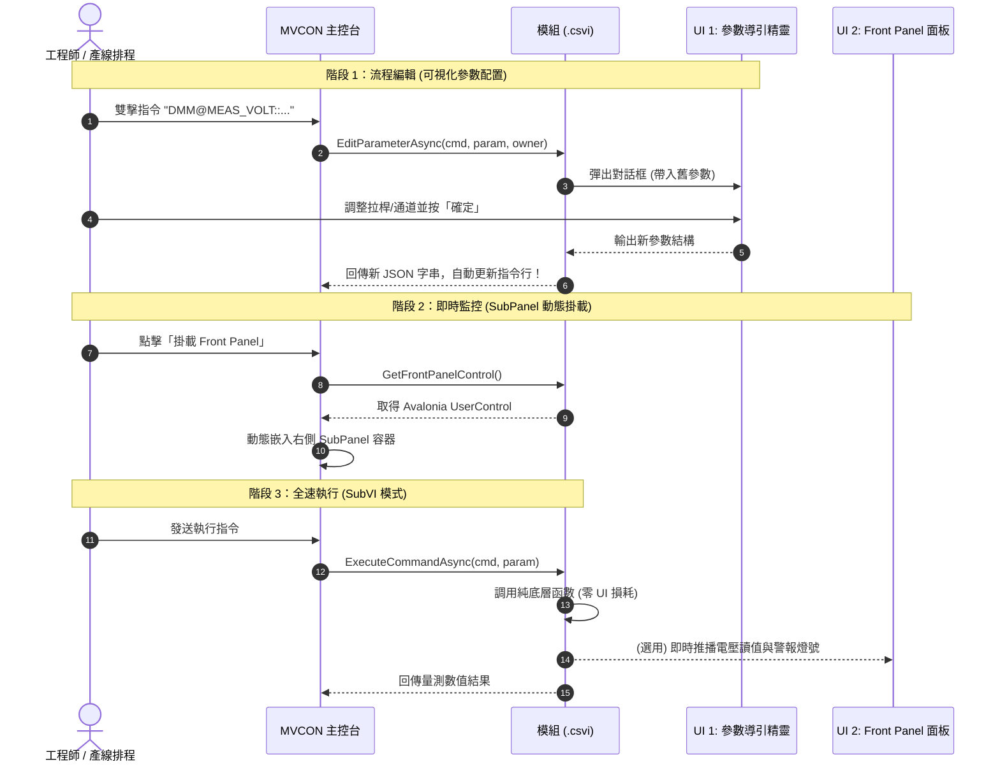
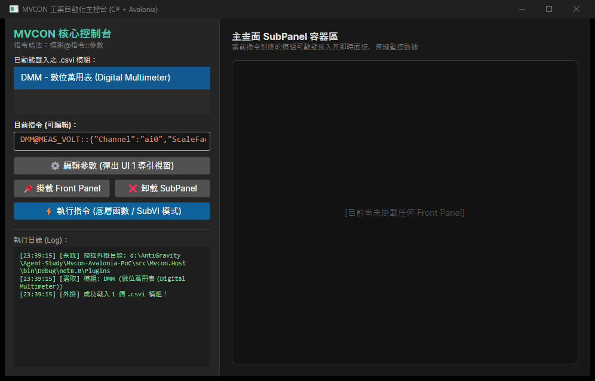
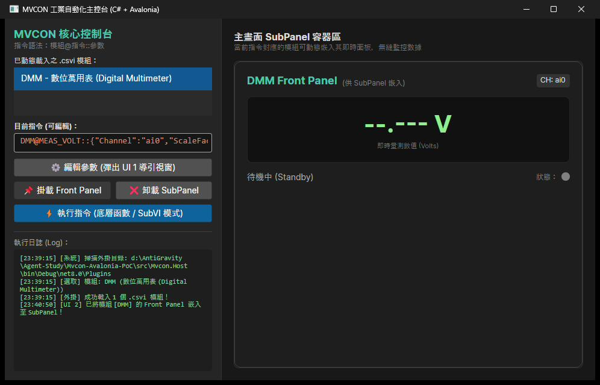
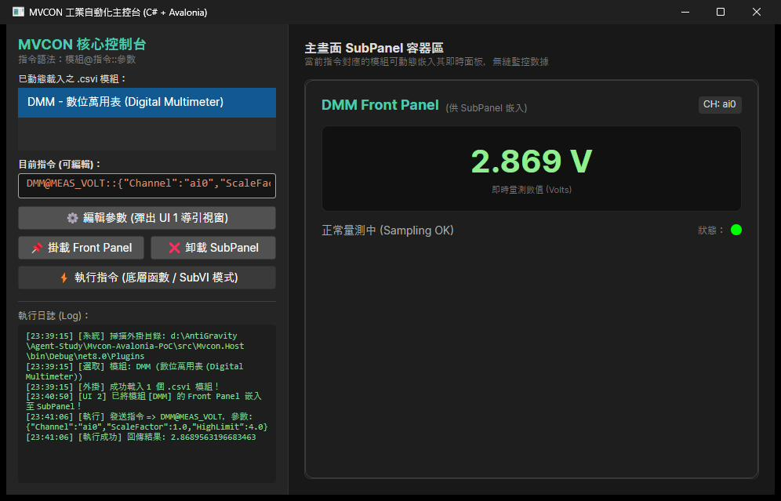

# MVCON CSVI Architecture (C# + Avalonia)
### 🚀 現代跨平台工業自動化與測試模組體系 (LabVIEW CSVI Pattern Reimagined)

<p align="center">
  
  
  
  
  
</p>

<p align="center">
  <a href="#english-overview"><b>English</b></a> | <a href="#繁體中文說明"><b>繁體中文</b></a> | <a href="./CSVI_ARCHITECTURE.md"><b>Detailed Spec (完整規格書)</b></a>
</p>

---

<a name="english-overview"></a>
## 🌐 English Overview

**MVCON CSVI (Configurable SubVI)** is an industrial automation and automated test equipment (ATE) modular architecture built with **C# (.NET 8) and Avalonia UI**. 

It brings the visual and operational power of **NI LabVIEW’s SubVI / Express VI** into modern software engineering:
1. **Three-in-One Assembly (`.csvi`)**: Packaging **Core Engine (headless calculation)**, **UI 1 (Config Wizard Dialog)**, and **UI 2 (Live Front Panel UserControl)** into a single self-contained DLL renamed to `.csvi`.
2. **Standardized Command DSL**: Structured syntax `Module@Command::Parameters` for human readability, configuration recipes, and Git version control.
3. **True Cross-Platform & Zero-License Bound**: Runs natively on Windows, Linux industrial PCs (IPC), and headless servers without multi-gigabyte proprietary runtime engines.
4. **Dynamic SubPanel Embedding**: Front panels dynamically dock into the host shell, or execute with zero UI overhead in production mode.

---

### ⚡ Architecture Comparison: LabVIEW vs. MVCON CSVI

| Concept | Traditional NI LabVIEW | **MVCON CSVI (C# + Avalonia)** |
| :--- | :--- | :--- |
| **Component Format** | Binary `.vi` (proprietory, merge conflicts) | Standard .NET Assembly compiled as `*.csvi` |
| **Pure Computation** | Block Diagram (SubVI call) | **Core Engine** (C# static/async method, 0 UI overhead) |
| **Parameter Setup** | Express VI Configuration Dialog | **UI 1: Config Wizard** (Modal dialog generating `::Params`) |
| **Runtime Display** | Front Panel / SubPanel container | **UI 2: Front Panel** (Avalonia `UserControl` dynamically mounted) |
| **Execution Syntax** | Graphical wires / Connector Panes | Structured DSL: `Module@Command::Parameters` |
| **Cross-Platform** | Windows-heavy, complex Linux RT licensing | Fully native cross-platform via Avalonia 11 & .NET 8 |

---

### 🏗️ The Four Facets Pattern (四位一體架構)

- **Zero USERPARAMETEREDITOR Folder**: Completely eliminated!
- **Directory-Driven Discovery**: File count in MODULES/<Module>/ directly defines supported commands and drivers.

```text
┌────────────────────────────────────────────────────────┐
│                   MyModule.csvi                        │
│                                                        │
│  [Pillar 1] Headless Core Engine (Pure C#)             │
│    - Zero UI dependency, high-performance async I/O    │
│    - VISA / SCPI / DAQmx / Algorithms                  │
│    - Full-speed headless execution for production lines│
│                                                        │
│  [Pillar 2] UI 1: Parameter Wizard Dialog              │
│    - Manages and visualizes "::Parameters" (JSON)      │
│    - Pops up on double-click; writes back clean string │
│                                                        │
│  [Pillar 3] UI 2: Live Front Panel Control             │
│    - Avalonia UserControl for SubPanel embedding       │
│    - Real-time waveforms, gauges, and Pass/Fail LEDs   │
└────────────────────────────────────────────────────────┘
```

---

<a name="繁體中文說明"></a>
## 🇹🇼 繁體中文說明

**MVCON CSVI (Configurable SubVI)** 是專為工業自動化控制、機器視覺檢測（AOI）與自動化量測系統（ATE）設計的現代模組化架構。

長年使用 LabVIEW 的工程師深知其「Block Diagram 背景算、Front Panel 彈性秀、雙擊節點導引設參數」的直覺威力。本專案透過 **C# (.NET 8) + Avalonia UI**，將這套經典開發哲學完整現代化，擺脫龐大 Runtime 引擎與授權綁定，全面擁抱跨平台工控時代！

---

## 📌 指令語法規範 (Command DSL Specification)

MVCON 系統的核心調度完全基於結構化的領域特定語言：

$$\Large \mathbf{模組@指令::參數}$$

* **`模組@` (Module)**：對應動態載入的 `.csvi` 外掛名稱（例如 `DMM@`, `CAM@`, `MOTION@`）。
* **`@指令` (Command)**：該模組支援的底層動作或函數（例如 `@MEAS_VOLT`, `@SNAP`, `@MOVE_REL`）。
* **`::參數` (Parameters)**：純文字 JSON 格式。**工程師無需記憶繁瑣欄位，由模組自帶的 UI 1 導引精靈直覺編輯產生**！

```text
# 典型指令範例：
DMM@MEAS_VOLT::{"Channel":"ai0","ScaleFactor":1.0,"HighLimit":4.0}
```

---

## 🔄 模組運作時序 (Sequence Diagram)



---

## 📸 實機驗收畫面 (Screenshots)

本架構已透過 **Antigravity Desktop Cockpit (ADC)** 完成端到端自動化驗證：

| 1. 主控制台初始化 (載入 .csvi) | 2. 動態掛載 Front Panel 儀表 | 3. 底層執行與即時數值跳動 |
| :---: | :---: | :---: |
|  |  |  |

---

## 🏗️ 專案目錄結構 (Project Structure)

```text
mvcon-csvi-architecture/
├── Mvcon.sln                             # 完整 Visual Studio / JetBrains Rider 解決方案
├── CSVI_ARCHITECTURE.md                 # 深度架構規格手冊
├── src/
│   ├── Mvcon.Contracts/                  # 共用契約規範庫
│   │   ├── Mvcon.Contracts.csproj
│   │   └── ICsviModule.cs                # 核心模組介面 (EditParameter, GetFrontPanel, ExecuteCommand)
│   │
│   ├── Modules/
│   │   └── DmmSensorModule/              # 範例模組 (建置後自動產出 DmmSensorModule.csvi)
│   │       ├── DmmSensorModule.csproj    # 內建 MSBuild Post-Build 更名複製 Target
│   │       ├── Models/
│   │       │   └── VoltCommandParam.cs   # 指令參數結構 (JSON 序列化)
│   │       ├── Core/
│   │       │   └── DmmCoreEngine.cs      # [底層函數] 純數據採樣/演算 (零 UI 依賴)
│   │       ├── Views/
│   │       │   ├── DmmParamWizardWindow  # [UI 1] 參數設定精靈視窗 (編輯 ::參數)
│   │       │   ├── DmmFrontPanelView     # [UI 2] 即時 Front Panel 儀表面板
│   │       │   └── DmmFrontPanelViewModel.cs
│   │       └── DmmSensorCsvi.cs          # 模組對外進入點 (實作 ICsviModule)
│   │
│   └── Mvcon.Host/                       # MVCON 前端主控台 (Avalonia 11 桌面程式)
│       ├── Services/
│       │   └── CsviPluginLoader.cs       # 動態掃描 Plugins/*.csvi (Assembly.LoadFrom)
│       ├── MainWindow.axaml / .cs        # 整合介面 (指令編輯、SubPanel 容器、日誌監看)
│       └── Program.cs / App.axaml
```

---

## 🚀 快速上手 (Quick Start)

### 1. 環境需求
- [.NET 8.0 SDK](https://dotnet.microsoft.com/download/dotnet/8.0) 或更高版本。
- 支援 IDE：Visual Studio 2022、JetBrains Rider 或 VS Code (搭配 C# Dev Kit)。

### 2. 編譯與建置
```bash
# 還原並建置整個解決方案
dotnet build Mvcon.sln
```
> **提示**：建置 `DmmSensorModule` 時，MSBuild Target 會自動將編譯後的 DLL 改名為 `DmmSensorModule.csvi`，並直接部署至主程式的 `Plugins/` 資料夾！

### 3. 啟動主程式
```bash
cd src/Mvcon.Host
dotnet run
```

### 4. 測試體驗重點
1. **測試 UI 1 (編輯參數)**：點擊「⚙ 編輯參數」，彈出精靈視窗調整通道與上限，按確定後指令行的 `::參數` 會自動重組更新！
2. **測試 UI 2 (SubPanel 嵌入)**：點擊「📌 掛載 Front Panel」，右側容器瞬間切換為專屬儀表。
3. **測試底層執行 (SubVI 模式)**：點擊「⚡ 執行指令」，底層非同步採樣完成，儀表數值與警報指示燈同步跳動！

---

## 📄 開源授權 (License)

本專案採用 [MIT License](LICENSE) 開源授權。歡迎自由擴充、引用與提出 Pull Request！
