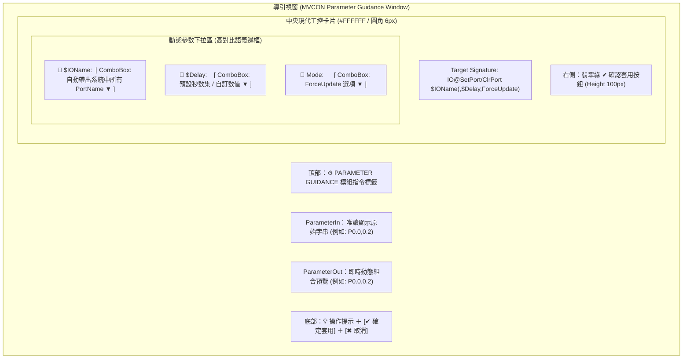
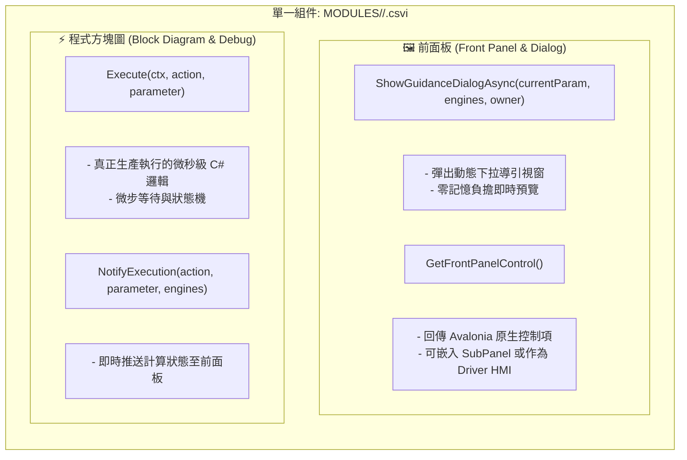

# MVCON 指令參數導引視窗與 CSVI 設計原則規格書 (Guidance Window & CSVI Principles)

## 一、 核心哲學：零記憶負荷原則 (Zero Cognitive Load Principle)

> [!IMPORTANT]
> **MVCON 參數導引的核心金科玉律：**
> **「只要這個參數內容在系統中查得到，導引視窗就必須自動感知並帶出來給使用者選，嚴禁要求工程師手動默背與拼寫輸入！」**

在現代精密自動化機台與產線中，存在成百上千個 IO 點位、馬達軸代號、點位座標變數、相機名稱、演算法 ROI 與流程標籤。若要求工程師在編寫腳本時手動輸入純文字，極易發生拼寫錯誤（Typo）、大小寫不一致、點位名稱遺忘等致命失誤，導致機台撞機或流程異常。

因此，所有 **CSVI 參數導引視窗（Parameter Guidance Wizard）** 必須貫徹以下三大鐵則：
1. **動態發現與自動感知 (Dynamic Auto-Discovery)**：開啟導引視窗時，必須向核心引擎 (`BasicEngines`) 即時檢索當前系統已配置的所有實體與邏輯資源。
2. **語義選單與防呆 (Semantic ComboBox & Fool-Proofing)**：以具備搜尋/過濾功能的下拉選單（ComboBox）取代傳統純文字 TextBox，使用者「點選即填入」。
3. **即時雙向拼接預覽 (Real-time Concatenation & Bidirectional Sync)**：上層控制項變動時，即時於下方 `ParameterOut` 組合出標準腳本語法；反之傳入現有參數時，自動拆解並反選對應的下拉項目。

---

## 二、 八大核心模組參數感知清單 (Module Discovery Matrix)

| 模組 | 指令範例 | 需自動帶出之參數 | 系統檢索來源 (Engine API) | 呈現控制項 |
| :--- | :--- | :--- | :--- | :--- |
| **IO 模組** | `IO@SetPort` `IO@ClrPort` `IO@WaitPortOn` `IO@WaitPortOff` `IO@CheckLogicOn` | **`$IOName`** / **`$PortName`** | `engines.Io.GetAllPortNames()` （包含所有自訂別名如 `Cylinder_Extend`、`Vacuum_1` 與實體點 `P0.0`~`Pn.m`、系統虛擬點） | **紅色高亮下拉框 (Red Border ComboBox)** |
| | | `$Delay` | 常用延遲預設集合 (`0.0`, `0.05`, `0.1`, `0.2`, `0.5`, `1.0`, `2.0`)，支援自訂數值 | **藍色高亮下拉框 (Blue Border ComboBox)** |
| | | `ForceUpdate` | 選項：`""` (無) 或 `"ForceUpdate"` | **藍色高亮下拉框 (Blue Border ComboBox)** |
| **Motion 模組** | `Motion@GoPoint` `Motion@WaitMotor` `Motion@Home` `Motion@Stop` | **`$MotorName`** | `ctx.Drivers.GetDeviceNames("Motion")` （已註冊之馬達/軸清單，如 `Motor1`, `RobotGantry`, `X`, `Y`） | **紅色高亮下拉框 (Red Border ComboBox)** |
| | | **`$PointName`** | `engines.Point.GetAllPointNames()` （所有已計算點位，如 `P1`, `P_Inspect`, `P_Safe`） | **綠色高亮下拉框 (Green Border ComboBox)** |
| | | `$Speed` | 速度百分比預設 (`10`, `20`, `50`, `80`, `100`) | **藍色高亮下拉框 (Blue Border ComboBox)** |
| **Capture 模組** | `Capture@Snap` `Capture@Trigger` `Capture@PatternMatchOne` `Capture@FindCircle` | **`$CamName`** | `ctx.Drivers.GetDeviceNames("Capture")` （已配置之實體與模擬相機，如 `Cam1`, `CamTop`） | **紅色高亮下拉框 (Red Border ComboBox)** |
| | | **`$ROIName`** | `engines.Image.GetAllROINames()` （已定義之視覺搜尋區域，如 `ROI_Align`, `ROI_Barcode`） | **綠色高亮下拉框 (Green Border ComboBox)** |
| | | `$ImaqIndex` | `engines.Image.GetAvailableImaqIndices()` (`0`~`N`) | 下拉選單 |
| **Variable 模組**| `Variable@Set` `Variable@Inc` `Variable@Dec` `Variable@Delete` | **`$VarName`** | `engines.Variable.GetAllVariableNames(section)` （當前 Section 與 Global 已定義之所有變數名稱） | **紅色高亮下拉框 (Red Border ComboBox)** |
| **Thread 模組** | `Thread@Jump` `Thread@Call` | **`$TargetLabel`** | `ctx.Program.GetAllLabels()` （當前 Program 腳本中所有 `Thread@Label` 定義之標籤） | **紫色高亮下拉框 (Purple Border ComboBox)** |
| | `Thread@Run` `Thread@Wait` | **`$ThreadID`** | 主執行緒 (0~12) 與子執行緒清單 | 下拉選單 |
| **System 模組** | `System@Record` `System@LogRecordCycleTime` | **`$RecordName`** | `engines.Timer.GetRecordNames()`（已使用之測時名稱） | 下拉選單 |
| | `System@TimerCheck` | **`$TimerName`** | `engines.Timer.GetTimerNames()` | 下拉選單 |
| | `System@CounterCheck` | **`$CounterName`** | `engines.Variable.GetCounterNames()` | 下拉選單 |

---

## 三、 UI 佈局與視覺規範 (Visual & Interactive Specification)

專屬導引視窗採用以下標準配色與佈局：

### 3.1 高對比語義邊框定義
* **紅色高亮邊框 (`#DC2626` / 1.5px)**：核心必填實體資源（如 `$IOName`、`$MotorName`、`$CamName`）。
* **綠色高亮邊框 (`#16A34A` / 1.5px)**：幾何點位與視覺特徵（如 `$PointName`、`$ROIName`）。
* **藍色高亮邊框 (`#2563EB` / 1.5px)**：數值型修飾參數（如 `$Delay`、`$Speed`、`ForceUpdate`）。
* **紫色高亮邊框 (`#9333EA` / 1.5px)**：流程邏輯與跳轉目標（如 `$TargetLabel`）。

### 3.2 互動行為契約
1. **輸入回填（Input Parsing）**：開啟視窗時自動解析 `currentParam`，下拉選單自動反選匹配項目。
2. **即時組合（Live Concatenation）**：控制項變動時無延遲更新 `ParameterOut`。
3. **一鍵套用（One-Click Apply）**：按下 `✔`、底部「確定套用」或按下鍵盤 `Enter` 立即關閉並回傳。
4. **原生動態引用（In-Process Dynamic Calling）**：導引視窗與主程式同進程，直接以記憶體引用調用 `BasicEngines`。

---

## 四、 CSVI「四位一體」實踐規格

在 CSVI 架構下，不再有分離的彈窗專用資料夾。每個指令（如 `MODULES/IO/SetPort.csvi`）均為獨立的 CSVI：

### 部署路徑統一：
所有 CSVI 統一置於：
- 指令：`MODULES/<Module>/<Action>.csvi`
- 驅動：`MODULES/<Module>/DRIVER/<DriverName>.csvi`
- **徹底廢棄 `USERPARAMETEREDITOR` 目錄**。
